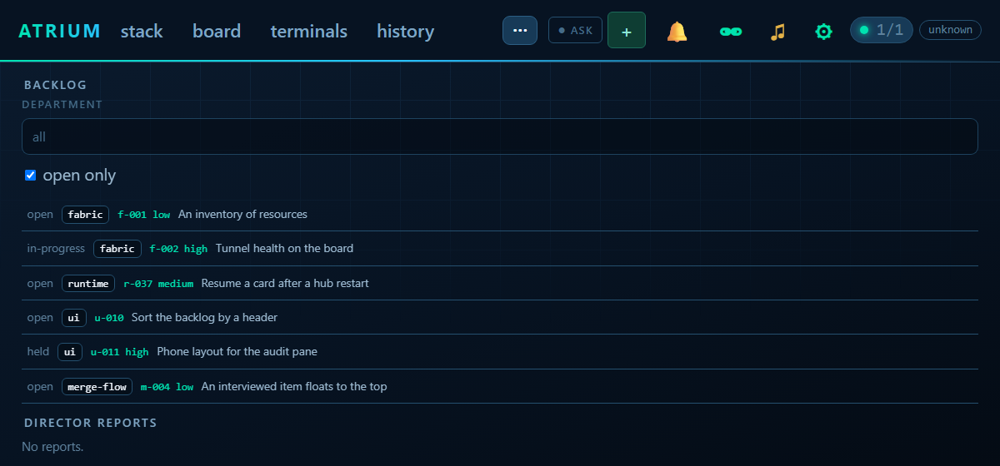
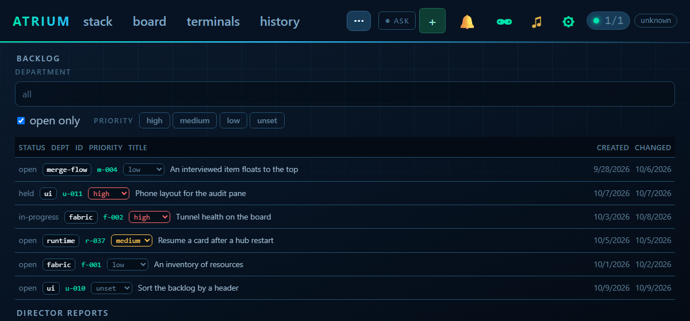
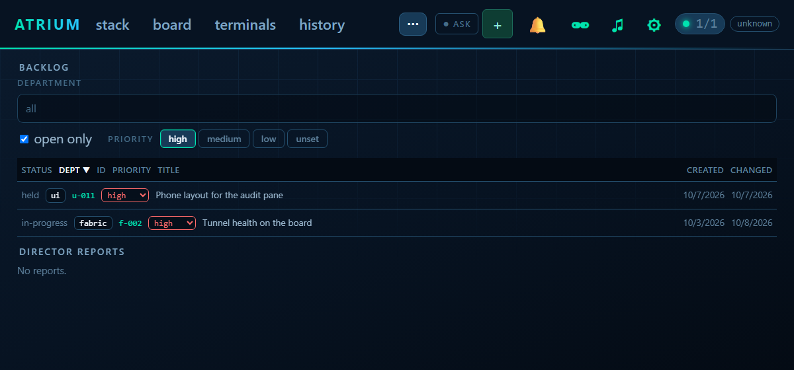

# Backlog priority: one of four values, changeable, sortable, filterable

## The spec

Hub backlog item `u-backlog-priority-sort`, verbatim:

> Today `priority` is free text on the hub's backlog (HIGH, MEDIUM, LOW, blank), unchecked.
> - Priority is one of high, medium, low, or unset. The hub normalises existing rows (HIGH -> high, blank -> unset), and atrium_backlog / `atrium backlog file` refuse anything else with the allowed list. Schema: CHECK constraint, migration at the end of the slice, tolerant statements (AGENTS.md).
> - A way to change it: `atrium_backlog` action `priority {id, priority}`, the CLI, and a click on the board.
> - Backlog page: sortable by priority, status, dept, created, changed; click a header to sort, again to reverse. Default sort: interviewed items first (field may be empty today), then priority high to low, then newest.
> - Filter chips for priority beside the existing ones.

## What was built

- **Store** (`internal/hubstore`): migration `0014_backlog_priority` is last in the slice. It rebuilds `backlog_item` with `CHECK (priority IN ('','high','medium','low'))`, the way the room store's 0010 and 0014 widen a CHECK, and copies the old text folded to lower case and trimmed: `HIGH` becomes `high`, blank stays unset, anything that is not one of the three (`p2`, `urgent`) becomes unset. The statements tolerate a half-applied run (`DROP TABLE IF EXISTS` of the scratch table first, `CREATE INDEX IF NOT EXISTS` after). `NormPriority` is the one place a typed priority is judged: case and space are forgiven, `unset` and `none` mean empty, anything else is refused with `priority "x" is not allowed: it is high, medium, low, or unset (empty)`. `ItemSetPriority` changes one, `ItemFilter.Priority` narrows a list.
- **HTTP** (`internal/link/backlog.go`): `POST /_hub/backlog/<id> {priority, by?}`, `GET /_hub/backlog?priority=`. Filing and importing refuse a bad priority with the same sentence (400). A change writes a `backlog-priority` audit line and a `backlog` event.
- **Tool** (`atrium_backlog`): action `priority {id, priority}`, and `priority` narrows `list`. `file` refuses a bad priority.
- **CLI**: `atrium backlog priority <id> <high|medium|low|unset>`, `atrium backlog list --priority`, `file --priority` takes the four values.
- **Board** (`js/backlog.js`): clickable headers for status, dept, id, priority, title, created and changed. A first click sorts (priority high first, created and changed newest first, the rest A to Z), a second reverses. The default order is interviewed items first (`interviewed` on the item, absent today), then priority high to low, then newest created. Priority chips beside the department and open-only filters toggle high, medium, low and unset, and none lit means all. Each row's priority is a select: changing it posts to the hub, and a refusal is said in a line under the filters.

The interviewed state itself is not built here; the sort only reads `interviewed` when the hub sends it.

## Pictures

Made with `scripts/shoot-backlog.js` (headless Playwright, `wholeBoard()` and mocked endpoints).

Before (free text, newest filed last, no sort):

After (default order: the interviewed item, then high, medium, low, unset):

After, sorted by dept twice (reversed) and filtered to high:

## Test plan

### A. Priority is one of four

1. `atrium backlog file x-1 --dept fabric --title t --priority urgent`.

**Expected:** refused, naming high, medium, low and unset.

2. `atrium backlog file x-1 --dept fabric --title t --priority HIGH`, then `atrium backlog show x-1`.

**Expected:** priority high.

3. `atrium backlog priority x-1 unset`, then `atrium backlog list --priority unset`.

**Expected:** x-1 is listed, priority `-`.

### B. The board

1. Open the backlog tab on a hub. Click the `dept` header, then click it again.

**Expected:** the rows order by dept, then reverse. The header shows the direction.

2. Light the `high` chip, then the `low` chip.

**Expected:** only high, then high and low, rows show. Unlighting both shows all.

3. Change a row's priority from its select.

**Expected:** the row keeps its new value after the list reloads, and the `atrium backlog show` of it agrees.

### C. An existing hub

1. Start a hub on a database that has items with `HIGH`, blank and `p2` priorities.

**Expected:** they read `high`, unset and unset, and nothing else about the items changed.