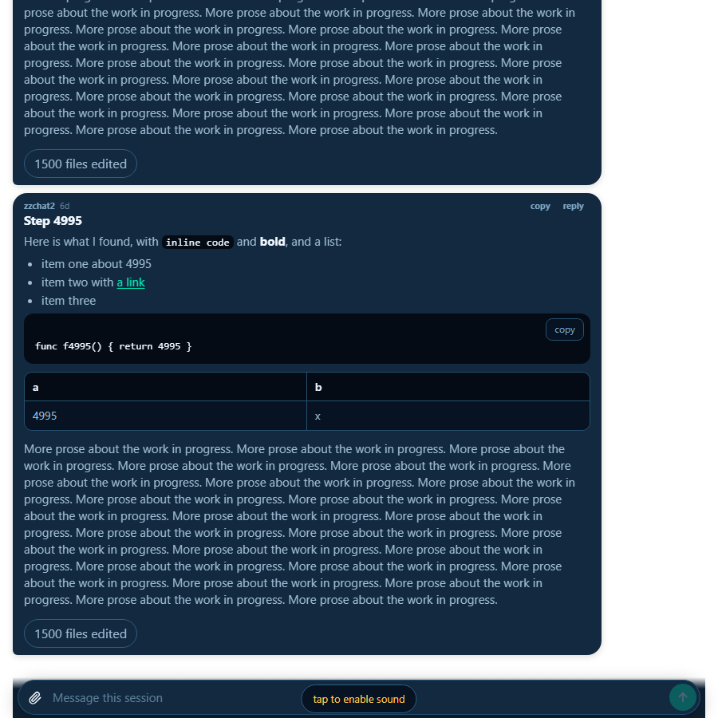

# bug-chat-view-slow-load

The chat view (`js/chat.js`, an iframe on `/m/?chat=1#term=<id>`) of a long card loaded slowly. This is where the time
went, measured on this room (sgg) with a synthetic card, and what changed.

## Where the time went

A card with 500 prompts and about 3000 replies, an 86 MB transcript, behind a local `atrium daemon`:

| Piece | Cost | Verdict |
| --- | --- | --- |
| Board side: page, 40 static files, `/v1/tasks`, settings, harnesses | first bubble drawn 94 to 134 ms in Chromium | not it |
| `/replies?n=50` payload | 66 KB, 50 replies and prompts, already windowed and paged by `before` | not it |
| Rendering 50 replies (md, code, tables) | inside the 94 ms above | not it |
| Room read of the last 2 MB window | 5 ms warm | not it |
| `turnsOf`, the first scan of the whole transcript | 0.16 s at 86 MB, 0.4 s at 400 MB, once per file then incremental | small |
| `fillEdited`, the per-reply "N files edited" chip | **1.08 s on every call** | the cost |

`fillEdited` resolves every file an edit tool call named in the reply's turn through `safepath.Contained`, which is
several syscalls each (root and target, symlinks, Windows). The count was recomputed on every `/replies` read even when
the page came from cache, so a turn that names thousands of files (an orchestrator's long turn) cost about a second
each time the card was opened and at every turn end. The synthetic card has 2 turns of 1500 distinct files each.

## What changed

`internal/daemon/turns.go`: the chip's resolver (`resolveInsideMemo`) remembers each path's answer for 10 minutes, up
to 50000 paths. `/changes` still resolves directly because it names the files. No API shape changes, the board and
phone are untouched. A deploy of the room is enough, and it is the orchestrator's.

| `/replies?n=50` through the daemon | before | after |
| --- | --- | --- |
| card with 2 long turns, first read | 1.2 s | 0.43 s (86 MB scan plus 3000 resolutions once) |
| same card, every later read | 1.08 s | 2 ms |
| card with 500 short turns | 0.04 s | 0.002 s |

The count can lag a symlink swapped inside the worktree by up to 10 minutes. It is a chip, not a gate.

## Turn end to answer drawn

Clint watched the phone chat of the orchestrator over ziti: the thinking bubble stopped, then about 10 s passed before
the answer drew. The path is a turn-end hook, the room's 400 ms check (`outputCheckDelay`), the phone re-reading
`/replies?n=50`, and drawing. Measured in Chromium against the synthetic card (an answer appended to the
transcript, then the idle hook posted, time to the answer's text being in the thread):

| | before | after |
| --- | --- | --- |
| turn end to answer drawn, local loopback | 1.7 s | 0.65 s |
| `/replies` read at a turn end (API alone) | 350 ms | 20 ms |
| `/replies` bytes on the wire, 50 replies | 66 KB | 1.5 KB here, about a quarter for real prose |

Two changes. The chip resolution above, now kept 10 minutes so a turn end does not pay it again. And `/replies` is
gzipped when the caller accepts it (`internal/api/replies.go`, a room change, the hub proxy passes the header and the
body through untouched). Uncompressed, every read moved 60 KB or more, and a turn end makes two (turn end, then the
`output_at` move), which over ziti is the likeliest piece of a 10 s gap. The remaining 0.65 s is the room's 400 ms
wait, which stays so the line being written has landed.

Not measured: the 10 s over ziti itself. This room has no overlay path to sg4, so the link's share is argued from
bytes, not timed. If it persists after deploy, time `curl --compressed` of that URL from the phone's side.

Not measured: the orchestrator's own transcript on sg4, and the hub and overlay path. If the real card is
still slow after this, ask for `time curl <hub>/v1/tasks/<id>/replies?n=50` on sg4 to see whether it is the room or the
link. 

## Test plan

## @LETTER@. A long turn does not slow the conversation

### @LETTER@1. Open a card with a long turn

1. Open the chat view of a card whose latest turn edited hundreds of files.
2. Open it again, and let a turn end.

**Expected:** replies appear in well under a second each time, and the "N files edited" chips show the same counts.
