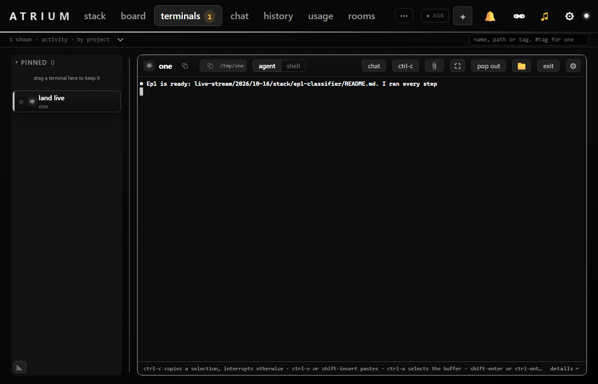
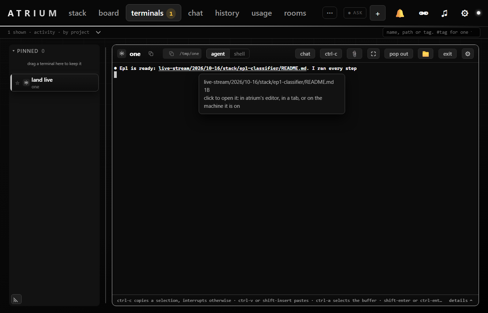

# bug-terminal-path-no-link

A claude reply path (`live-stream/.../README.md`) did not underline on hover although `files/probe` found it.

**Cause.** `useFileLinks` registers its provider once, with `task.id` as the terminal opened. A room flip respells
the card in place (`retagTermId` sets `termTask.id`), and `provideFileLinks` then compared `termTask.id !== id`
whole, so every row answered no links for the rest of the terminal's life. Fix: compare by `bareId` and probe, and
open, under the id the pane holds now.

## Test plan

## @LETTER@. A path stays a link after a room flip

### @LETTER@1. The claude reply line

1. Attach a card from another room and print `● Ep1 is ready: dir/sub/README.md. I ran every step` where the file exists.
2. Let the room set change so the card's id is respelled with its room tag, then hover the path.

**Expected:** the path is underlined and clicking it opens the file menu, as before the flip.