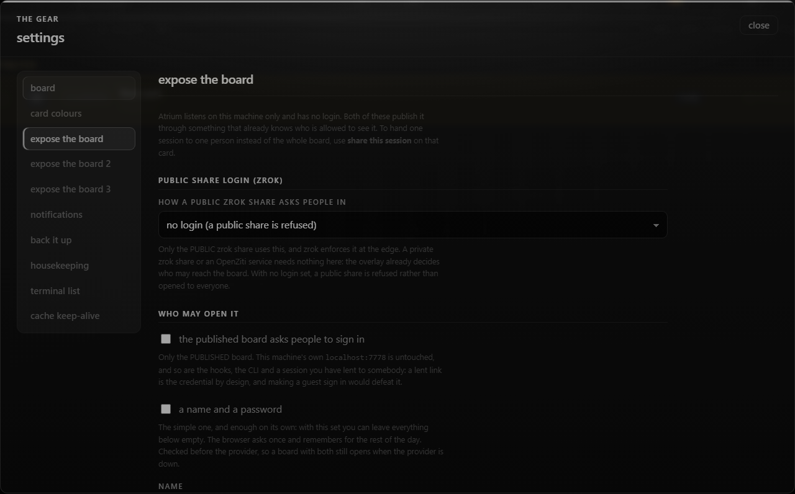
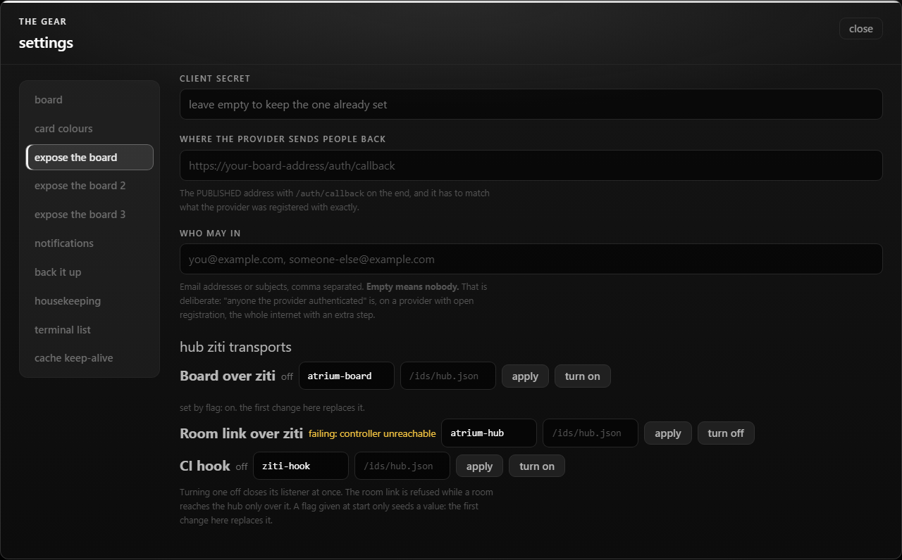

## Test plan

## @LETTER@. The hub's ziti transports as settings

### @LETTER@1. Off and on from the gear

1. On a hub with a ziti identity, open the gear, "expose the board", and find "hub ziti transports". It lists
   `Board over ziti`, `Room link over ziti` and `CI hook`.
2. Press `turn on` on the board row, then `turn off`.

**Expected:** the row reads `bound` within a minute after the first press, and `off` after the second. After the second
the hub's log stops dialling the ziti controller when no other transport that is on uses that identity. The audit log
has `hub-transport-on` and `hub-transport-off` lines.

### @LETTER@2. The room link is kept while a room needs it

1. With a room attached only over ziti, press `turn off` on `Room link over ziti`.

**Expected:** the message reads `refused: <room> reaches this hub only over ziti`, and the row stays on.

### @LETTER@3. A flag seeds, the gear replaces

1. Start the hub with `--ci-hook-service ziti-hook`. The CI hook row says `set by flag: on, service`.
2. Turn it off, restart the hub without the flag.

**Expected:** the row is off, and no longer says it is set by a flag.

### @LETTER@4. A failing bind retries slowly

1. Turn on a transport with the controller down.

**Expected:** the row reads `failing: <why>`, and the hub's log shows a retry no more often than every 30 seconds, later
every 10 minutes at most.

### @LETTER@5. From elsewhere it is read-only

1. Open the board over a share or an overlay, and press a switch.

**Expected:** the hub answers 403 and the row says it is set on the hub's machine.

