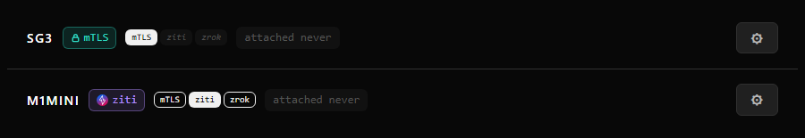
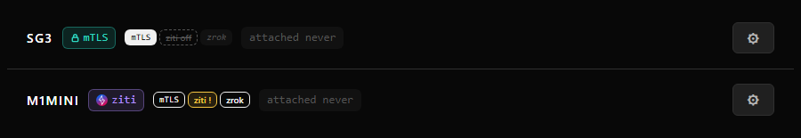

## Test plan

## @LETTER@. Turning a room's overlay transport off and on

### @LETTER@1. Off and on from the rooms page

1. On a room that reaches the hub on direct and also has a ziti identity, open the Runners tab. The room shows a
   `direct`, a `ziti` and a `zrok` badge.
2. Press the `ziti` badge and confirm.
3. Press it again, now reading `ziti off`.

**Expected:** after step 2 the badge reads `ziti off` (struck through, dashed), the room stays attached, and its room
log stops dialling the ziti controller. The room's `transports.json` lists `"off": ["ziti"]`. After step 3 the badge
returns to a live state within a minute and the file no longer lists it. No runner is touched in either step.

### @LETTER@2. The last path is kept

1. On a room whose only working path is ziti (direct unreachable), press the `ziti` badge.

**Expected:** a toast says `refused: ziti is this room's last working path to the hub, so it stays on`, and nothing
changes.

### @LETTER@3. A restart keeps the choice

1. Turn ziti off on a room, then restart that room.

**Expected:** the room starts with ziti off, logs `turned off here: ziti`, and attaches over direct without dialling the
ziti controller.

### @LETTER@4. A refusing controller is not hammered

1. Point a room's ziti rung at a controller that refuses connections (stop the controller on a test network).

**Expected:** the room's log shows at most about one ziti dial a minute once it has backed off, the ziti badge reads
with a `!` while the failures come fast, and the room stays on its other transport. The same through `atrium_transport`
with `room` and `transport` and `on`, and with neither `transport` nor `on` it reads each state.

