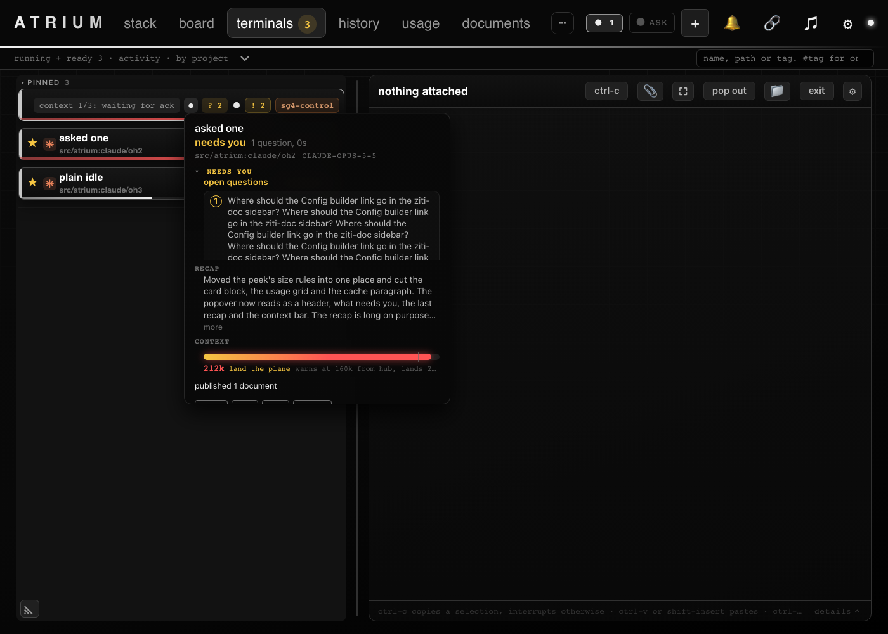
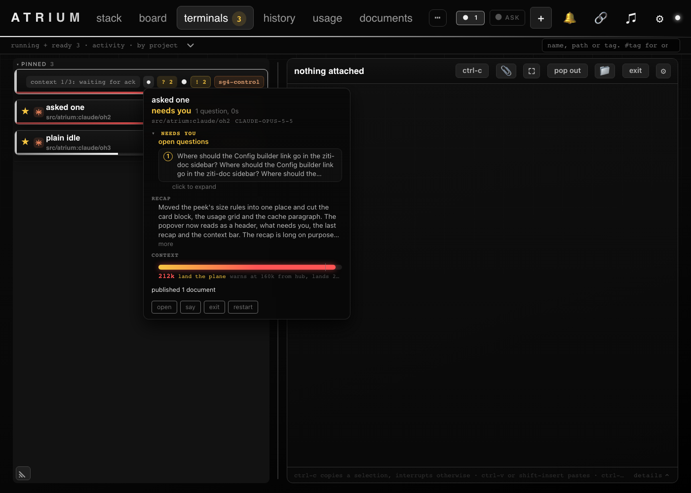
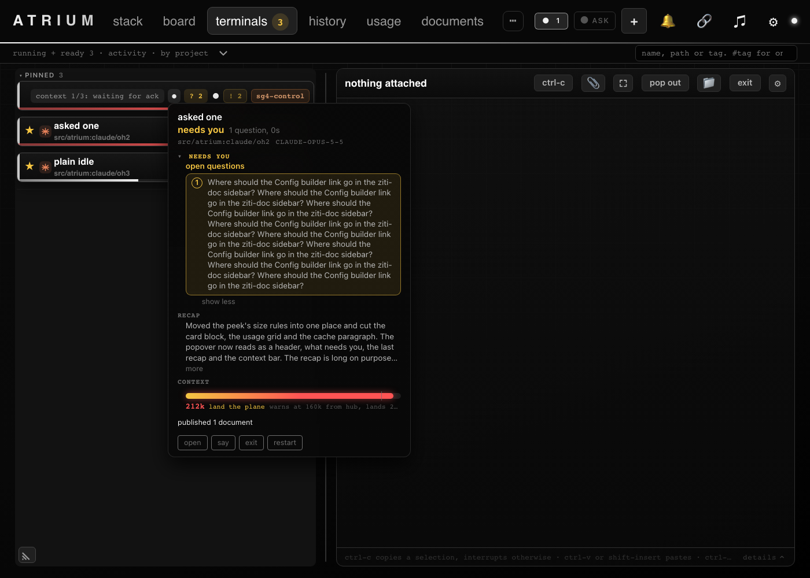

# The hover popup never scrolls

The card hover popup used to put the open questions in a block capped at 9.5em that scrolled, and capped the whole
popup at 460px. Now each question is cut to three lines with a "click to expand" button under it. Expanding grows the
popup, which is fitted again with `popFit` (`peekRefit` in `js/peek.js`) so it stays inside the viewport. The chatter
list lost its own cap too, since it already pages with "more". The popup body only scrolls when the window is shorter
than the content, which `popFit` has always allowed.

Before, a long question clipped inside a scrolling block:

After, three lines and a way to expand, then the full text:

Code: `js/peek-answers.js` (`qaClamp`, `qaOpenSet`), `js/peek.js` (`peekRefit`), `css/cards.css`. Test: the
`peekOneHover` headless unit.

## Test plan

## @LETTER@. The hover popup does not scroll

### @LETTER@1. A long question

1. Hover a card that has an open question of several sentences.

**Expected:** the question shows three lines and "click to expand". No scrollbar anywhere in the popup.

### @LETTER@2. Expand it

1. Click "click to expand".

**Expected:** the whole question shows, the popup grows and stays inside the window, the button reads "show less".
