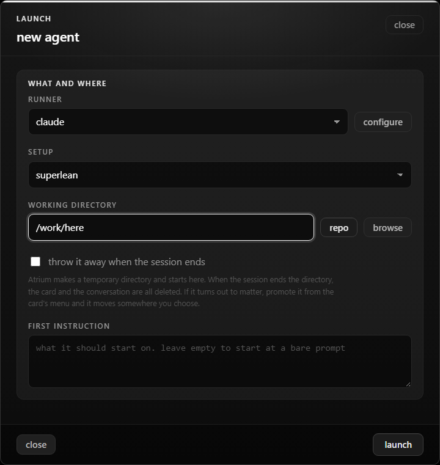

## Test plan

## @LETTER@. Superlean in the launch dialog

1. Open the launch dialog on a claude runner. A `setup` select shows, set to `full setup`.
2. Launch with full setup. The card has neither `atrium:lean` nor `atrium:superlean`.
3. Launch with `lean`. The card has `atrium:lean`.
4. Launch with `superlean`. The card has `atrium:superlean` and `atrium:lean`.
5. Pick a shell or codex runner. The select is hidden and the launch posts neither flag.
6. Pick superlean, close the dialog, open it again. The select is back on `full setup`.
7. Open the dialog to resume a card. The select is hidden.
