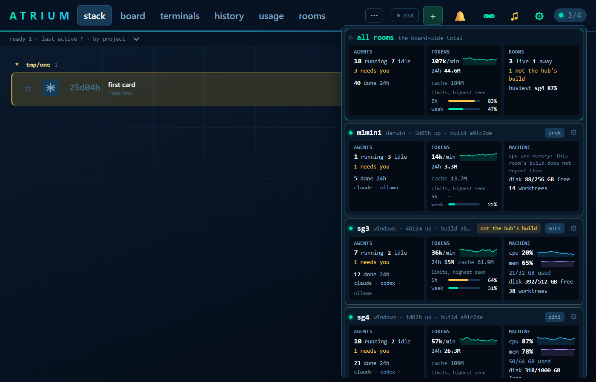
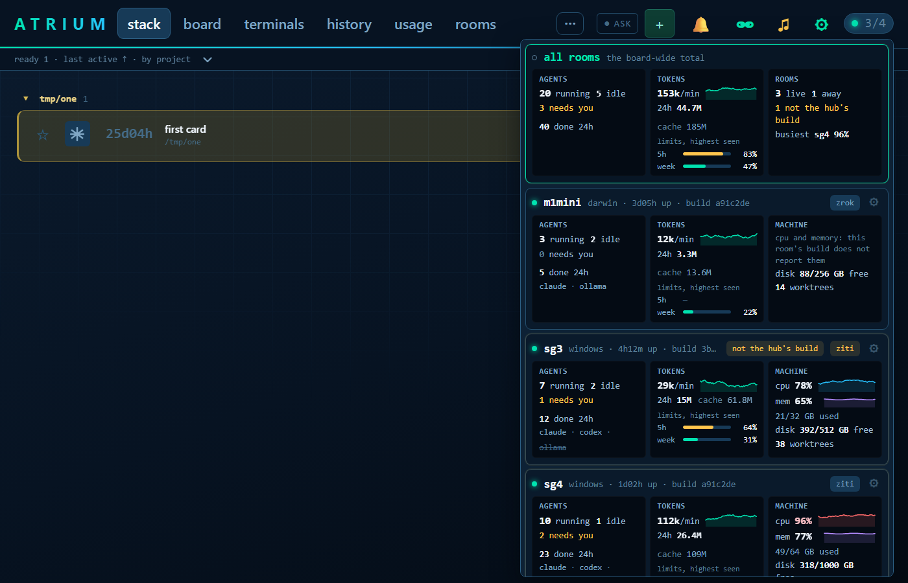

# The room link over an ordered list of transports

Design and decisions: `docs/rnd/room-transport-order.md`.




## Putting it on m1mini and sg3

m1mini and sg3 cannot reach the hub (sg4) over direct. They re-attach over OpenZiti once the steps below are done.
Atrium creates nothing in the ziti network. The ziti admin steps are done by whoever administers it.

### 1. Ziti network (admin, once)

```
ziti edge create service atrium-hub
ziti edge create service-policy atrium-hub-bind Bind --service-roles '@atrium-hub' --identity-roles '@<hub identity name>'
ziti edge create service-policy atrium-hub-dial Dial --service-roles '@atrium-hub' --identity-roles '#atrium-rooms'
ziti edge create identity m1mini -o m1mini.jwt -a atrium-rooms
ziti edge create identity sg3 -o sg3.jwt -a atrium-rooms
```

Copy `m1mini.jwt` to m1mini and `sg3.jwt` to sg3. A JWT is single use: it is enrolled once, by step 3.

### 2. Hub (sg4)

Restart the hub with the new binary and both transports, keeping every flag it already runs with:

```
atrium stop
atrium run --transport direct,ziti --atrium-identity <hub identity.json> --atrium-service atrium-hub <existing flags>
atrium rooms transports direct,ziti
atrium rooms transports
```

The last line prints the order rooms are told. It is read at every attach, so changing it needs no restart.

### 3. Each room (m1mini, sg3)

With the room stopped, put the new binary in place, then give the room its identity. On sg3 (Windows, PowerShell):

```
atrium stop
Copy-Item <new atrium.exe> $HOME\.atrium\bin\atrium.exe -Force
atrium room transports ziti --identity C:\path\to\sg3.jwt --service atrium-hub
atrium room transports
atrium room
```

On m1mini (macOS):

```
atrium stop
cp <new atrium> ~/.atrium/bin/atrium && chmod +x ~/.atrium/bin/atrium
atrium room transports ziti --identity ~/m1mini.jwt --service atrium-hub
atrium room transports
atrium room
```

`atrium room transports ziti --identity <jwt>` enrolls the JWT into `<room dir>/identities/` and records it. An
already enrolled identity `.json` is used where it is. The settings file is `<room dir>/transports.json`, by default
`~/.atrium/room/transports.json` (`%USERPROFILE%\.atrium\room\transports.json` on Windows). `WORKTREE_ROOT` or
`--dir` changes the room dir. `atrium room transports` should list direct first, then ziti with the identity path.
Start the room the way that machine normally does (`atrium room`, or its service).

### 4. Verify

- Room log: `[link] attached to hub ziti:atrium-hub as "sg3"` (or `"m1mini"`).
- On sg4: `curl http://127.0.0.1:7778/_hub/rooms` shows the room with `"via":"ziti"` and `"fallback":true`.
- Board: the room's transport badge reads `ziti` in the warning colour, and its settings say
  "connects over ziti (fallback)".
- When direct is repaired, the room moves back by itself within about four minutes (two good probes, two minutes
  apart) and the badge returns to `mTLS` in the plain colour.

## Test plan

## @LETTER@. Rooms fall back to a later transport, and come back

### @LETTER@1. The hub serves two transports in order

1. Start the hub with `atrium run --transport direct,ziti --atrium-identity <hub.json> --atrium-service atrium-hub`.
2. Run `atrium rooms transports direct,ziti`, then `atrium rooms transports`.

**Expected:** the hub logs a listener for each transport. The second command prints `direct,ziti`.

### @LETTER@2. A room configured for ziti attaches over direct first

1. On a room that reaches the hub directly, run `atrium room transports ziti --identity <room.jwt>`.
2. Run `atrium room transports`, then restart the room.

**Expected:** the ladder lists direct then ziti. The room attaches over direct. Its badge reads `mTLS` in the plain
colour.

### @LETTER@3. Direct does not answer

1. Block the hub's direct link port from that room (a firewall rule), and restart the room.

**Expected:** the room log says direct failed and then `attached to hub ziti:atrium-hub`. `/_hub/rooms` shows
`"via":"ziti","fallback":true`. The badge reads `ziti` in the warning colour with the tip "on ziti because its first
choice did not answer", and the room's settings say "connects over ziti (fallback)".

### @LETTER@4. Direct comes back

1. Remove the firewall rule and wait about four minutes.

**Expected:** the room reattaches over direct by itself. The badge returns to `mTLS` in the plain colour.

### @LETTER@5. A local order wins

1. On the room, run `atrium room transports order ziti,direct` and restart it.
2. Run `atrium room transports order --clear` and restart it again.

**Expected:** after step 1 the room attaches over ziti with no warning colour, since ziti is its first choice. After
step 2 it follows the hub's order again and attaches over direct.

### @LETTER@6. A refusal does not fall back

1. Mark the room for deletion on the hub (`atrium rooms mark <room>`), with both transports reachable.

**Expected:** the room is refused on direct and does not try ziti. It backs off as it always has.
