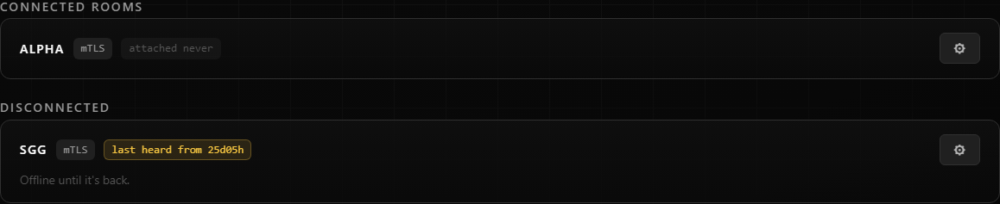
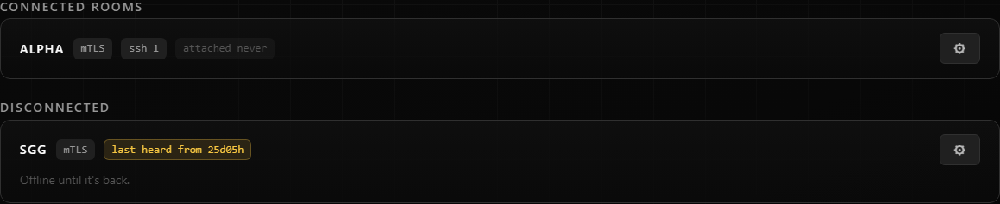
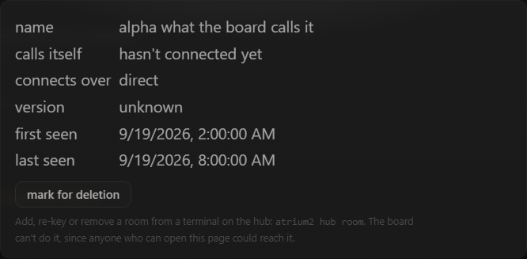
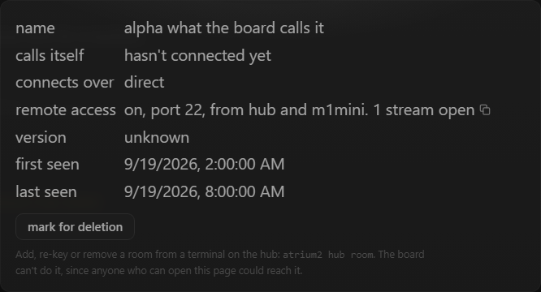
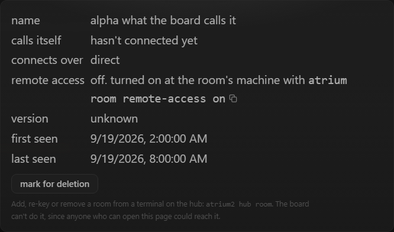

# ssh to a room's machine through the hub

Design and decisions: `docs/rnd/ssh-via-hub.md`.

A room can let the hub carry a TCP stream to its own sshd, over the link it already holds (direct mTLS, ziti or zrok).
The room decides: `remote_access.json` in its key directory, written only by `atrium room remote-access` at that
machine. Atrium carries bytes and nothing else. No key, password or agent socket passes through it, and the login is
sshd's.

What this adds:

- `atrium room remote-access [on|off|log]`, the room's switch, `ATRIUM_REMOTE_ACCESS=off` as a kill switch.
- `atrium ssh-proxy <room>`, ssh's `ProxyCommand`, with `--via hub|room` and `--print-config`.
- `atrium ssh config add|rm|show`, an opt-in helper that writes the Host blocks to `~/.ssh/atrium_config` and adds one
  `Include atrium_config` line at the top of `~/.ssh/config`. It is the one exception to atrium never editing that
  file, and it touches nothing else in it.
- An `ssh` badge and a `remote access` row (with a copy button for the config block) on the Rooms tab.
- `ssh-open`, `ssh-close` and `ssh-refused` audit lines on the hub, and `remote_access.log` on the room.

Before and after, the Rooms tab and the room's facts:

## Test plan

## @LETTER@. ssh to a room's machine through the hub

The target is **sg3**. The hub is on sg4 (claude-sg4 is its room). Run the caller side from each OS in turn: Windows
(sg4), macOS (m1mini) and Linux (sg4-wsl, test only). Every machine needs a build with this change and sshd running
on the target. Atrium is not deployed by this change: update sg3, sg4 and m1mini yourself first.

### @LETTER@1. Off by default, and only the room's machine turns it on

1. On sg3: `atrium room remote-access`.
2. From sg4: `ssh -o ProxyCommand="atrium ssh-proxy %h" claude@sg3`.
3. On sg4's board, open the Rooms tab and sg3's cog.

**Expected:** step 1 prints `remote access: off` and how to turn it on. Step 2 prints
`sg3 has remote access off. turn it on at that machine: atrium room remote-access on` on stderr, then ssh's own
`Connection closed`, and the hub's audit shows an `ssh-refused` line. Step 3 has no `ssh` badge and the row reads
`off. turned on at the room's machine with atrium room remote-access on`, with no toggle anywhere.

### @LETTER@2. Turn it on at sg3

1. On sg3: `atrium room remote-access on --from hub,m1mini`.
2. Inside a session atrium supervises on sg3, run the same command.

**Expected:** step 1 prints `remote access: on, port 22, from hub, m1mini`. Step 2 refuses with
`remote access is turned on by a person at this machine, not by an agent`. Within a few seconds the Rooms tab shows an
`ssh` badge on sg3 (tip `remote access on, from hub, m1mini`) and the row reads
`on, port 22, from hub and m1mini. 0 streams open`.

### @LETTER@3. The config block for each OS

Run on each caller. It prints the block for the machine it runs on.

1. `atrium ssh-proxy --print-config sg3`
2. On the board, press the copy button on sg3's `remote access` row, and paste it somewhere.

**Expected:**

- **sg4 (Windows):** `ProxyCommand "C:\...\atrium.exe" ssh-proxy %h`, the absolute path in double quotes. The board's
  button gives `"atrium.exe"` quoted, which assumes atrium is on PATH.
- **m1mini (macOS) and sg4-wsl (Linux):** `ProxyCommand /path/to/atrium ssh-proxy %h`, plain and unquoted. The board's
  button gives `atrium ssh-proxy %h`.
- Every block has `HostKeyAlias sg3.atrium`, `ServerAliveInterval 30` and `CheckHostIP no`, and no port is opened on
  the machine.

### @LETTER@4. The ssh config helper

On each caller, use a throwaway home if you would rather not touch the real one (`HOME=/tmp/h` or `$env:USERPROFILE`).

1. `atrium ssh config show`
2. `atrium ssh config add sg3`
3. `atrium ssh config add sg3` again.
4. On sg4 only, the hub's machine: `atrium ssh config add --all`. On m1mini it must refuse with a sentence telling you
   to name the rooms.
5. `atrium ssh config rm sg3`, then `atrium ssh config show`.

**Expected:** step 2 writes `~/.ssh/atrium_config` (`%USERPROFILE%\.ssh\atrium_config` on Windows), adds
`Include atrium_config` as the FIRST line of `~/.ssh/config` after copying it to
`config.atrium-backup-<timestamp>` beside it, and creates the config with only that line when there was none. Step 3
says nothing changed and makes no second backup or second Include. Every other line of `~/.ssh/config` is byte for
byte as it was (`diff` it against the backup, the only difference is the added first line). Step 5 removes the block
and leaves the Include line.

### @LETTER@5. ssh, scp and a forward from sg4 (Windows)

1. `ssh sg3.atrium` (the Host block from step 4 is in use), then `hostname` and `exit`.
2. `scp C:\Windows\System32\drivers\etc\hosts sg3:/tmp/hosts-from-sg4`
3. `ssh -L 8080:127.0.0.1:7781 sg3`, then in a browser open `http://127.0.0.1:8080`.
4. With step 3 still open, on sg4's board look at sg3's `ssh` badge. Then exit.

**Expected:** every step reaches sshd on sg3 and asks for the login sshd would ask for. The first thing ssh prints
about the host is its key, under the name `sg3.atrium`. Step 3 shows sg3's own board. Step 4 shows `ssh 1` (the count
of open streams) while the forward is open and the audit has `ssh-open` with `hub -> sg3 over <transport>` and
`claims <user>@<host>`, and after exit an `ssh-close` line with the duration, the bytes each way and who ended it.

### @LETTER@6. From m1mini through its own room

1. On m1mini: `atrium ssh config add sg3`, then `ssh sg3.atrium`. m1mini is not the hub, so the hub door is not there and
   the stream goes through its room's agent listener.
2. On sg3: `atrium room remote-access on --from hub` (m1mini no longer on the list), then on m1mini `ssh sg3.atrium` again.
3. Put m1mini back with `--from hub,m1mini`.

**Expected:** step 1 works, and the audit names the caller `m1mini -> sg3`. Step 2 fails with
`sg3 does not offer ssh to m1mini`. The `ssh` already open from step 1 and left open ends within ten seconds of the
list changing.

### @LETTER@7. From sg4-wsl (Linux, test only)

1. `atrium ssh-proxy --print-config sg3` and `atrium ssh config add sg3`.
2. `ssh sg3.atrium hostname`.

**Expected:** the plain path form, and sg3's hostname printed.

### @LETTER@8. Turn it off in the middle of a session, from each caller

For each of sg4, m1mini and sg4-wsl in turn:

1. Open `ssh sg3.atrium` and leave it at the prompt, running `while true; do date; sleep 1; done`.
2. On sg3: `atrium room remote-access off`.
3. `atrium room remote-access log`.

**Expected:** the session ends within ten seconds with `Connection closed`. sg3's log shows the close with
`ended by remote access being turned off`, and the hub's audit has the matching `ssh-close` with the same stream id.
The badge is gone from the Rooms tab. A new `ssh sg3.atrium` is refused in words. `ATRIUM_REMOTE_ACCESS=off` in sg3's
environment keeps it off even after `on`, and the row says it is forced.

### @LETTER@9. What must not work

1. In a browser on sg4: `fetch("/_hub/ssh/sg3", {method: "POST"})` from the board's console.
2. `curl -i -X POST -H "Connection: Upgrade" -H "Upgrade: atrium-stream" -H "Origin: http://x" http://127.0.0.1:7778/_hub/ssh/sg3`
3. `curl -i http://127.0.0.1:7778/_link/ssh`
4. If the board is also shared over zrok or ziti, the same POST through the share.

**Expected:** step 1 is refused (it is not an upgrade, and carries an Origin). Step 2 answers 403
`a page cannot open an ssh stream`. Step 3 answers 404. Step 4 answers 404 whatever the share's login said. No
`ssh-open` line appears for any of them.
