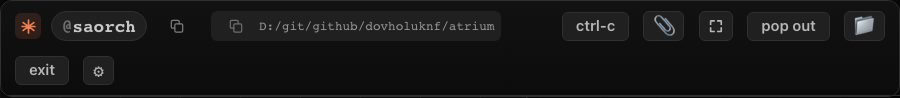

## Test plan

## @LETTER@. The @handle chip copies instead of explaining

### @LETTER@1. The terminal header

1. Attach a terminal for a card that has an alias and look at the header.
2. Hover the `@handle` chip.
3. Click the copy icon right after it, then paste somewhere.
4. Click the chip itself.

**Expected:** hovering shows no tooltip. The icon turns into a check mark for about a second and no toast appears.
The paste is `@handle`. The click on the icon does not open the rename, and the click on the chip does.

### @LETTER@2. The card row

1. Find a card with an alias on the board and hover its `@handle` chip.
2. Click the icon after it, then paste.

**Expected:** no tooltip on the chip, the paste is `@handle`, the card is not selected and no rename opens.

### @LETTER@3. Selecting text

1. Drag across the chip and the icon to select the text.

**Expected:** nothing is copied and the rename does not open.

