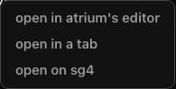
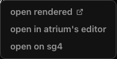

## Test plan

## @LETTER@. A markdown link in a terminal offers "open rendered" first

Before:  After: 

The phone board has no file-link menu in its terminal, so nothing changes there.

### @LETTER@1. A markdown path

1. Print `docs/plan.md` in a terminal and click it.

**Expected:** the menu lists "open rendered" with an open-in-new-tab icon first, then "open in atrium's editor". Picking
"open rendered" opens the rendered page in a new browser tab.

### @LETTER@2. Any other file

1. Print `src/beta.go` in a terminal and click it.

**Expected:** the menu keeps "open in atrium's editor" first, then "open in a tab", which now carries the icon.
