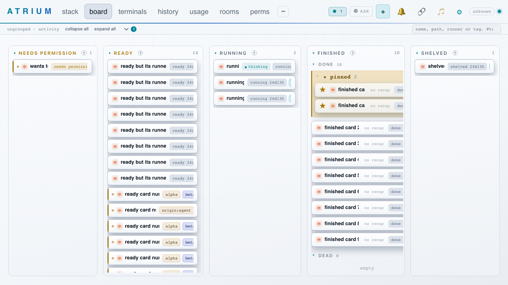
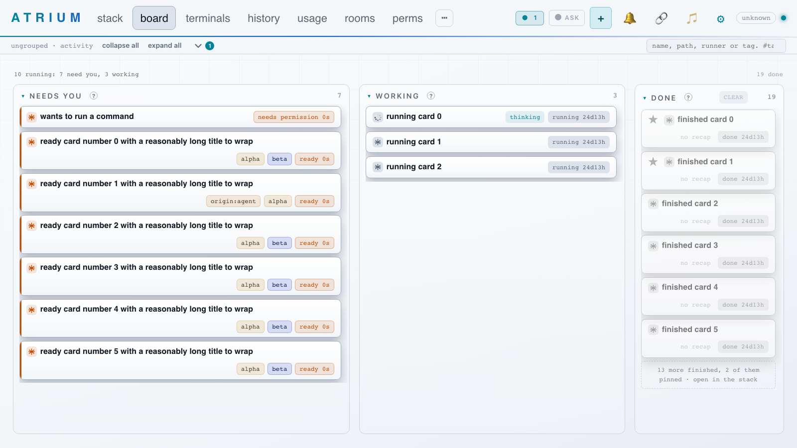

# One card everywhere: the board and the shared rules

Built from `docs/rnd/unified-card.md` as changed by `docs/rnd/unified-card-decisions.md`. Before and after:

## What is built

- `cardState(t)` in `js/cardrules.js`: `waiting`, `working`, `live`, `off`, `unreachable`. `cardLive` and `workingNow` moved
  there with it. Held by `scripts/test-notify-rules.js`.
- `boardColumnOf(t)` and `BOARD_COLUMNS` (`js/core.js`): inbox (hidden when empty), needs you, working, done. `COLUMNS`, the
  stored statuses, is untouched because the stack pills, the move-to menu and the reveal still read it.
- The board: columns from `boardColumnOf`, the count line `N running: X need you, Y working` and `Z done`, done capped and
  fixed width, no pinned group (a pin is the star and a sort key), chips wrap, attach and pop-out on hover only, no pulse
  dot, no live-chip animation, one spinning runner mark.
- `--wait` (`css/tokens.css`, light skins in `css/themes.css`): the one orange, used for waiting and nothing else. A
  contrast row in `scripts/check-contrast.js`. The runner marks are neutral (`--label`), orange only on a waiting card.
- Group colours stay as they are (decision 4).

## Decisions made here

1. **Scope.** This ships the shared state and the board. The stack, the terminals list and the phone are not rebuilt on a
   shared `cardFace`: they still draw their own rows. They do get the neutral runner mark and the `--wait` token by CSS,
   and `workingNow` now lives in the shared file. `cardface.js`, the stack, terminals and phone follow-ups are next steps.
2. **BOARD_COLUMNS beside COLUMNS** rather than rewriting COLUMNS with `holds(t)`, to leave the stack and the move-to menu
   alone.
3. **A card on a room that is not answering** (`unreachable`) is filed by the status it last had, in its column's
   "not answering" group, and drawn dashed, not grey.
4. **Done cap.** The 6 most recent, or every card active in the last 24 hours, at most 12, pinned first. The more row
   counts every pinned card in done ("17 of them pinned"), not only the hidden ones. It opens the stack with `finished`
   and `shelved` shown.
5. **Needs you order.** Permission, then open question, then ready, longest wait first, regardless of the board sort.
6. **`clear` on done** deletes `done` and `dead` cards only. Shelved and parked cards stay.
7. **Contrast.** `--wait` is held to the file's label floor (2.8), not 4.5, and the 25 degree hue check is not written.
   Light skins (paper, daylight, linen, frost) use 192,78,0, everything else 255,122,26.
8. **A runner-gone, unsupervised card's state chip** reads `stopped`, not `ready`.
9. **Blocked.** There is no blocked status, so nothing is built. The rule is recorded in the decisions doc.
10. `isOutOfContact` stays because `js/peek.js` and the stack still call it. The board no longer does.
11. `scripts/shoot-board-tab.js` now mocks one card per state, for the captures above.

## Open for clint

- Should the state chip join the title's line on the board (the design's anatomy)? Today the chips still sit right of the
  title and wrap under it when crowded.
- Do you want the stack, terminals and phone moved onto the shared card next, in that order?

## Test plan

## @LETTER@. One card on the board

### @LETTER@1. Columns follow the runner

1. Have a ready card with a live agent, one waiting on a permission, one mid-turn, and a ready card whose agent exited.

**Expected:** the first two are in needs you (permission first), the mid-turn card is in working with a spinning mark, the
exited one is grey in done. The count line reads `3 running: 2 need you, 1 working` and `1 done` at the right.

### @LETTER@2. Done is capped

1. Finish more than twelve cards and open the board.

**Expected:** done draws at most twelve, pinned first, then `N more finished, M of them pinned`. Clicking it opens the stack
with only finished cards. The column does not widen. Folding done still works.

### @LETTER@3. One orange

1. Compare a waiting card started by an agent with one you started.

**Expected:** both have the same orange edge, chip and mark. No other card uses that orange, and no card has a pulsing dot.
