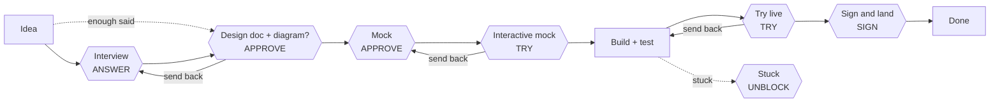

# Your queue: every item's stage and the one thing it needs from clint

Interview with clint, 2026-11-21. Backlog item u-your-queue. Related: f-item-lifecycle, u-backlog-plan-start-work,
u-009. Next step: an interactive mock filled with the real open items and the asks of the day, from another card.

## Why

clint, verbatim: "i find i have to type a lot and i prolly make you work harder than i should as i don't have any
context." He wants one place to see what needs him and knock it off, and software engineering discipline around it:
"diagrams when making big decisions. doc tied to it all that".

## Requirements

### Stages and gates

1. Idea and Interview are two stages. The interview may be skipped when the idea already says enough.
2. Every stage records two things: **Your input** (what clint said or agreed) and **AI distillation**.
3. Mocks and interactive mocks are kept in git with the item, so any room anywhere can pull the item and start, run or
   pick it up at any stage, including mid-interview. Nothing gets rebuilt.
4. Small items skip stages (a bug fix goes idea, build, sign). The rest of the proposed flow is accepted as is.



Hexagons are gates that wait on clint. Each gate asks one verb: answer, approve, try, sign, or unblock.

### Diagrams

At the design stage the agent asks "does this need a diagram?" each time. It skips the question when the answer is
obviously no.

### Where item files live

1. Never flat. A system, subsystem and component tree, at least one level deeper than system/subsystem:
   `design/<system>/<subsystem>/<component>/<item-id>/` holding `item.md` (stage history, decision line at top),
   `design.md`, `mocks/`, `interview.md`.
2. Folder lifecycle matters. Proposed: on Done the decision and final diagram fold into that subsystem's README, and
   the item folder moves to an `_archive/` beside it, mocks kept. Dropped items archive with the reason at the top.
3. One overall "how it all works" doc per project (`design/HOW-IT-WORKS.md`) linking down to each subsystem README.

### Generic, not atrium-specific

clint: "this is not ATRIUM SPECIFIC... This process needs to be generic for any project. Maybe an atrium.spec.md type
idea that describes it all?" Confirmed shape: one `atrium.spec.md` at each project's root, read by the board and by
agents. It declares the stages and per-project overrides, what each gate asks, the system tree, where design files
live (branch or folder), and what Done means for that project. Atrium ships a default spec a new project copies.

### Where the queue lives

1. On the Terminals tab: a **group by: needs you** option in the left-hand card list, plus a count badge ("5 for
   you", red when stuck) seen from every tab.
2. **Stuck items go at the top**, above every ask: crashed worker, failed CI, blocked agent.
3. "Needs you" comes from the item's stage gate, set by an agent tool call, not from agents remembering to ask for
   help. clint: "we HAD this in early atrium days but it never worked properly. there was no way to reliably have
   agents ask for help. i feel like atrium items can help here". Ship the grouping only if it is reliable.
4. clint on the larger goal: "if i get this 'right', i might never need terminal mode again".

### One row

Starting layout, to be tuned in the interactive mock ("we'll have to play with this to get it right"):

```
[stepper ●●●◐○○○]  Walk UI   TRY   waiting 2h   [Open]
```

Stepper of every stage, title, the type of need as one colored verb, age waiting on clint, one action. Clicking the
row expands the stage history (Your input and AI distillation per stage, links to doc, diagram, mocks).

### What a click opens

The main area switches to the ask, with a one-click toggle back to the plain terminal.

1. **Answer: a real interview UI, not the terminal.** One question at a time, the agent's recommendation, a reply box,
   each answer saved to the item as it happens (u-009). Yes or no questions get buttons. Multiple choice gets one
   button per choice. clint: so "i don't need to do what i usually do by providing you some 'grounding' text along
   with my reply". Each answer stays tied to its question without him quoting it back.
2. **Approve and Try are walks.** Step through the change or mock as the walk does today, end on Approve or Send back.
   Good enough to start, the mock will tell.
3. **Try gets annotate.** clint: "if i can click, draw/drag/drop make squares and arrows and annotate then 'click a
   button' and a capture and text is sent to the agent that would be fucking game-changing". Pins, boxes and arrows
   on the mock or live UI, each with a note, the element under it, the page, coordinates and an auto-cropped capture.
   One button sends the batch to the agent and records it as that stage's Your input. No more screenshots.
   Feasible for anything the board serves (card mocks, the board itself, same origin). A third-party page in a frame
   gets coordinates and a capture only.
4. **Sign** opens the walk with Sign and push.
5. **Stuck** shows the terminal with Restart, Unblock and Drop.
6. Asks that are not items yet (sign 312 commits, review the service plan doc) are filed as items, so every ask has a
   row.

### Never on it

Only things clint can act on. No inline help text, a hover help icon instead. Not shown: items an agent is working
with nothing waiting on clint, agent chatter and logs, stage explanations, anything waiting on another agent.

## Today's asks as rows

| Need | Item |
| --- | --- |
| APPROVE | bring-up mock |
| APPROVE | stepper mock |
| ANSWER | branch-cull interview |
| ANSWER | walk interview |
| TRY | walk UI live |
| SIGN | push 312 commits on claude/main to origin |
| APPROVE | service/package-manager plan doc |

## Open points

1. Sort and grouping inside "needs you" beyond stuck-first: by age, priority, or by need type.
2. All projects at once or one at a time. Suggested default: all, with a project chip and a filter.
3. Look and feel: clint says invent it. Starting point for the mock: a short "do these now" list over the row list,
   with a flow map (items as chips on the gate they wait at) as a toggle.
4. Whether annotate also works on Approve (static mocks, design diagrams). Assumed yes, unconfirmed.
5. Folder lifecycle details: fold-into-README on Done is proposed, not confirmed. Design home branch or folder is set
   per project in `atrium.spec.md`.
6. The gate signal must be reliable before the grouping ships: how an agent sets it, and how the board notices a gate
   that was never set.
7. Annotate is big enough for its own item.
