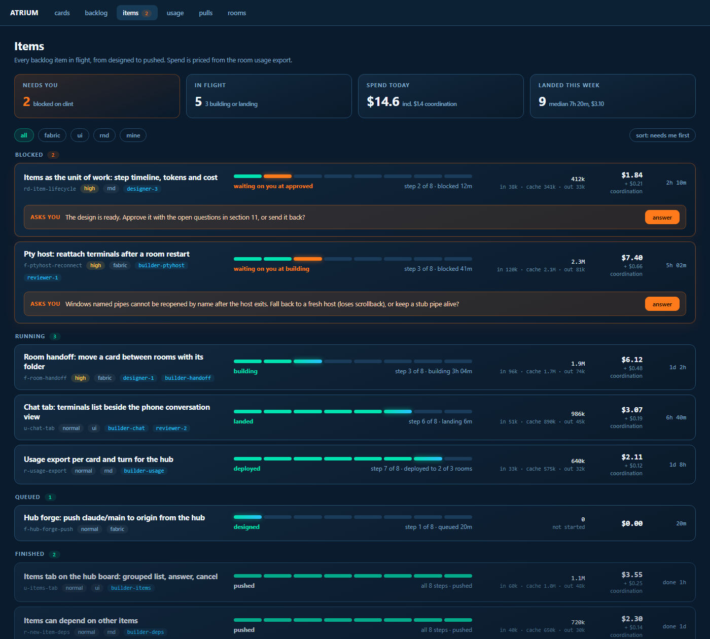
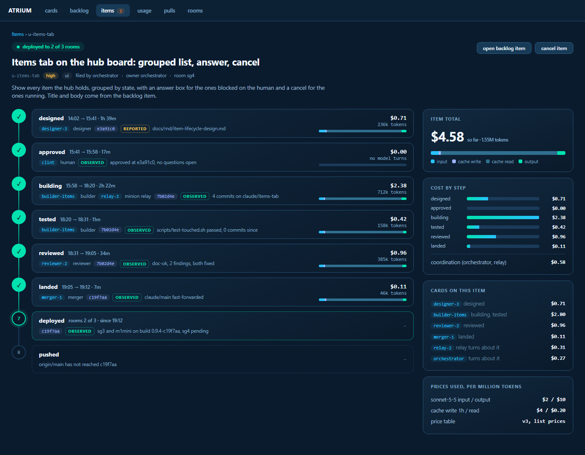
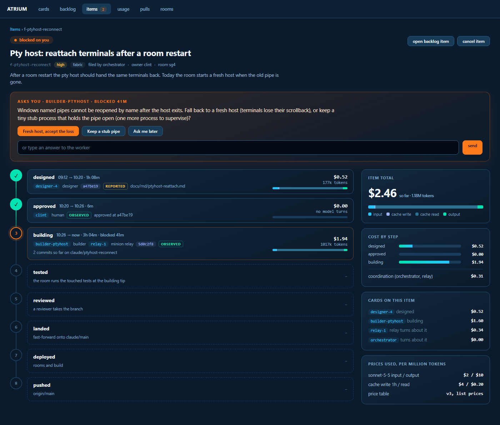

# Item lifecycle: an item is the unit of work from backlog to pushed, with a step timeline, cards, SHAs, tokens and cost

Status: approved by clint 2026-10-15 (section 11), L1 started. Efficacy (section 12) and stage L9 added the same day.

Origin: backlog item `rd-item-lifecycle`. clint, 2026-10-15, on the first items tab (6a574d9d): "looks not sexy at all.
it also seems to have no states, not designed, no working, no tested, no pushed ... i expect to see which card did
which step, i want to see how many tokens each step was and the cost for each step". He is right. The tab shows run
state (queued, running, blocked, finished) and a card id, and nothing else.

Read for this design, 2026-10-15:
- `docs/changes/items-stage1.md`, `items-stage2a.md`, `items-stage2b.md`, `items-stage3.md`, `items-view.md`;
- `docs/rnd/atrium-items-decisions.md` (the hub owns items, blocked is not finished);
- `docs/rnd/change-record-design.md` and `docs/rnd/change-lifecycle-design.md` (facts pinned to a commit);
- `internal/hubstore/item.go` (the item row, the push key `(item_id, revision, state)`);
- `internal/hubstore/backlog.go` (`BacklogItem`: id, dept, title, body, priority, status, card);
- `internal/api/usageexport.go`, `internal/store/usage.go` (`SessionUsage`), `internal/daemon/usage.go` (the price
  table), `internal/daemon/turncost.go` (cost of a turn by what caused it);
- `internal/api/web/css/tokens.css` and `css/items.css` (the board's theme variables).

Mockups, rendered at 1400 and 2400 wide from the HTML beside them (`img/item-lifecycle/*.html`, sharing `mock.css`,
which reuses the board's own custom properties):
- the list: `list-1400.png`, `list-2400.png`;
- one item's detail: `detail-1400.png`, `detail-2400.png`;
- a blocked item asking clint something: `blocked-1400.png`, `blocked-2400.png`;
- the efficacy view (section 12): `efficacy-1400.png`, `efficacy-2400.png`.

**Questions are held in section 11 for clint.**

## 0. The answer

- **An item is a backlog item at work.** One item per backlog id, with its title and body, and every card that touches
  it attached: designer, builder, tester, reviewer, merger, the minion relay and the orchestrator.
- **An item has eight steps, in order:**

  **designed, approved, building, tested, reviewed, landed, deployed, pushed.**

  Each step has a state, the card or cards that did it, a start and an end, and a commit SHA where one applies.
- **A step is derived from evidence, never set by a card.** Atrium reads git, the room link and the human's own clicks.
  A card's say-so counts only where nothing can be observed, and is labelled "reported". This is the rule of the
  change record, kept whole.
- **The change record is absorbed.** Its facts, its `at_sha` stamping and its "tested at abc1234, 3 commits ago" read
  become the item's step facts. There is no second record to keep in step with the first (section 5).
- **Tokens and cost are per step and per item.** Four token counts and a dollar figure from a per-model price table, split
  across steps by time, with coordination cost (orchestrator and relay turns about the item) shown as its own line
  (section 6).
- **Nothing runs without an item.** Every worker launch carries `--item <backlog id>` (section 8).
- **The tab is the item's story.** A list that reads at a glance and a detail that is the timeline (section 7).

## 1. What is there today

- **The item row** is one assignment: `item_id`, `room`, `card`, `generation`, `state`, `revision`, owner and a note.
  It has no title, no backlog id and no steps. The tab invents a title from the card's title.
- **Items are opt-in.** `item: true` on a launch tags the card `atrium:item` and strips its tools (no `say`, `peers`,
  `task`, `report`). That flag means "this worker is isolated", and it has been doing two jobs. One is "this card has an
  assignment the hub tracks". The other is "this card cannot talk". They must be pulled apart (section 8).
- **The backlog item** has the title, body and priority, and a single `card` field. It knows nothing of steps.
- **Facts about a branch** live in nobody's hands. `deployready` reads `Atrium-Verdict` trailers per commit, the pulls
  index holds PR runs, and the change record that would tie them to a branch was designed on 2026-10-02 and never built.
- **Usage** is a row per card per read of the transcript (`SessionUsage`: started, ended, model, input, output, cache
  write 5m and 1h, cache read). The room serves them as ndjson at `GET /v1/usage/export?since=`, which the hub can reach
  through its proxy. The dollar cost is stored on the row but deliberately left out of the export (`json:"-"`).
- **Prices** are in two Go maps in the room (`keepalivePrices`, `usageOnlyPrices`). A model with no price counts as
  zero.

## 2. The item

### 2.1 Names, so the tables stay readable

- In the UI and in this document an **item** is the unit of work, one per backlog id.
- The existing hub `item` table keeps its job and gets a plainer name in prose, an **assignment**: one card's run, with the
  queued, running, blocked, finished states from items stage 2a. It is not renamed in the schema. One item has many
  assignments over its life: the designer's, the builder's, a second builder after a restart, the reviewer's.

### 2.2 The hub tables

All on the hub, because the hub owns items (decisions section 1).

| table | holds |
| --- | --- |
| `work` | one row per backlog id: `backlog_id` (primary key), `title` and `body` (copied at attach, refreshed when the backlog item changes), `dept`, `priority`, `kind` (`code`, `doc` or `mixed`), `owner_kind` and `owner`, `branch` (the build branch, when one exists), `created_at`, `updated_at` |
| `work_card` | the cards attached: `backlog_id`, `room`, `card`, `role` (designer, builder, tester, reviewer, merger, relay, orchestrator), `step` (the step the launch named), `attached_at`. Many cards per item |
| `work_fact` | append-only facts: `backlog_id`, `kind`, `source` (`seen` or `reported`), `card`, `at_sha`, `dirty`, `at`, `payload` (text JSON) |
| `work_step` | the derived step rows, a cache: `backlog_id`, `step`, `state`, `started_at`, `ended_at`, `sha`, `cards` (text JSON), `reason` |
| `price` | the price table: `model`, `valid_from`, `in`, `cache_write_5m`, `cache_write_1h`, `cache_read`, `out` per million tokens |
| `work_usage` | usage rows ingested from the rooms, keyed by `(room, usage_id)`, with `backlog_id` and the card |

`item` gains one column, `work_id` (the backlog id), so an assignment says which item it belongs to.

The text `ULID-ish` keys, RFC3339 text times, `CHECK` instead of enums and TEXT instead of JSONB all hold, so the
schema stays Postgres portable.

### 2.3 One item per backlog id

`work.backlog_id` is the primary key, so a second launch with the same `--item` attaches another card to the same item
and starts another assignment. It never makes a second item. Re-opening a landed item (a bug found after landing) is a new
backlog item that names the first as `parent`, not a reopened row. A pushed item stays pushed.

### 2.4 Step states

| state | meaning |
| --- | --- |
| `pending` | nothing has started it |
| `active` | a card (or the human) is on it now |
| `blocked` | active, and an assignment on it is blocked. The reason and who is asked come from the assignment |
| `done` | the evidence for it holds at its sha |
| `stale` | was done, and the branch has moved on since. Shown with the count of commits since, the way the change record shows a test |
| `skipped` | not applicable, with a reason. A `doc` item skips building's tests and deploy, an item filed "build directly" skips designed and approved |

The item's **current step** is the first step that is not `done` or `skipped`. The item's state in the list (blocked,
running, queued, finished) is derived from that step and its assignments. It is no longer stored on its own.

## 3. The steps

For each step, what counts as evidence, what its SHA is, and whose cards are shown.

| # | step | done when | sha | cards shown | start and end |
| --- | --- | --- | --- | --- | --- |
| 1 | designed | a designer assignment finished with a sha that resolves, and the sha touches the design doc | the design commit | the designer | first designer assignment running, to its finish |
| 2 | approved | the human approved on the board, and the design doc has not changed since | the design sha approved | the human | designed done, to the click |
| 3 | building | a builder assignment finished with a sha reachable from the build branch | the branch tip when the builder ended | builder, and the relay | first builder running, to the last build commit |
| 4 | tested | a `test` fact at the tip says pass | the tip tested | whoever ran it | last build commit, to the test result |
| 5 | reviewed | a review verdict covers the tip (verdict trailer through the deployready matcher, or an `atrium_review` report) | the tip reviewed | the reviewer | review launched, to the verdict commit |
| 6 | landed | the build tip is an ancestor of `claude/main` on the hub's mirror | the first `claude/main` commit that contains it | the merger | review done, to the fast-forward |
| 7 | deployed | every room and the hub that the item's code runs on reports a build that contains the landed sha | the landed sha | none, or the director | landed, to the last room reporting |
| 8 | pushed | `origin/main` contains the landed sha | the landed sha | none | landed, to origin seeing it |

Notes:
- **Order is not strict in time.** A reviewer may start while the builder is still fixing, and deployed can begin on
  one room before another. The steps are a checklist with a current marker, not a pipeline that forbids overlap. A step
  can only be `done` when the steps before it are, so a landed branch with no review shows `reviewed` as `pending` and
  the item as stuck there, which is the truth about a branch that landed unreviewed.
- **Approved is a gate, not a card.** When the designer finishes, atrium creates the approval as an active step with
  no card and the human as the party. The board shows it as "waiting on you" (the blocked mockup shows the same
  treatment for a worker's question). Approve, or send back with a note. Sending back returns `designed` to active, and the designer's
  card gets the note typed as `atrium`.
- **Deployed has a scope.** Hub code deploys to the hub, room code to rooms, board code to whichever serves it.
  `deployready` already classifies a change as hub or room for its verdicts (`hub-ok`, `room-ok`), and the same
  classification gives the scope. A `doc` item has none, so `deployed` is `skipped`.
- **Staleness is the change record's.** A fact at an older sha is shown with the number of commits since. A step whose fact
  went stale is `stale`, and the current step moves back to it.

## 4. Who records each step, and how

The preference, in order: **observed by atrium, then reported by a card through a tool that atrium stamps, then not at
all.** A card never names a sha. For a reported fact the room runs `git rev-parse HEAD` in the card's own worktree and
adds the dirty flag, and refuses the call when the worktree's branch is not the item's branch (the change record's rule,
unchanged).

| step | recorded by | how | observed or reported |
| --- | --- | --- | --- |
| designed | the designer's `atrium_done` with a sha | atrium checks the sha exists and touches the design file | observed (the sha), reported (that this was the design) |
| approved | the human | a board action posts `by: board`, as answer and cancel already do. The hub writes the fact itself and pins the design sha | observed |
| building | the room's assignment push, plus git | start and end come from the assignment's running state. The sha comes from the hub's git mirror (`gitsync`) reading the branch | observed |
| tested | `atrium_record {kind: test}`, or atrium running the tests itself | the room stamps `at_sha` and the dirty flag and copies the log. `scripts/test-touched.sh` run by atrium (the `prove` path) writes a seen fact | observed when atrium ran it, otherwise reported |
| reviewed | the hub reading verdicts | an `Atrium-Verdict` trailer under deployready's rules, or an `atrium_review` report. A reviewer's own `atrium_done` is not evidence | observed |
| landed | the hub | `git merge-base --is-ancestor` on the mirror, when `gitsync` collects | observed |
| deployed | the room link | each room reports its build commit when it dials the hub, and again after a restart. The hub compares them with the landed sha | observed |
| pushed | the hub | `git ls-remote origin main`, when the hub refreshes (and immediately after a hub push) | observed |

What makes a step "ready" in the change record's sense still holds: only seen facts count for readiness. A reported
`tested` shows on the timeline with the amber **reported** tag and blocks `landed` from being shown as "ready to push",
until a seen test at the same sha exists. The timeline carries the tag on every step (`observed` in teal, `reported` in
amber), so clint can see the strength of each claim.

### 4.1 The engine

One pure function, `Derive(work, facts, assignments, gitView, builds) []StepState`, in `internal/link/lifecycle.go`. It
runs when something it reads changes:
- an assignment push (state, card, sha);
- `gitsync` finishing a collect;
- a room dialing in with a build stamp;
- a usage ingest (cost only, steps untouched);
- a board action (approve, send back, cancel).

It writes `work_step`, and the SSE stream the tab already listens to tells the board. Because the function is pure and
the facts are append-only, a bug in it is fixed by re-running it. Nothing in `work_step` is the only copy of anything.

### 4.2 Blocked

A worker's `atrium_blocked` keeps working as items stage 2a built it: the assignment goes `blocked`, the owner gets one
notice, and the owner (or the board, as the human) unblocks with an answer. What changes is where it shows. The step the
assignment sits on becomes `blocked`, and the item's list row and detail put the question where clint reads it first
(`blocked-1400.png`). The existing stuck timers (15 minutes for an owner who does not answer, 2 minutes for a worker who
does not resume) are unchanged.

## 5. How this replaces the change record

`change-record-design.md` proposed a record per branch or PR keyed by forge, repo and branch. For work atrium itself
does, that record has no better key than the item, so:

| change record | becomes |
| --- | --- |
| `change` row (forge, repo, branch) | `work.branch`. A branch belongs to at most one item |
| `change_fact` (`test`, `review`, `finding`, `push`, `ci`, `open`, `note`) | `work_fact`, same kinds, same `at_sha` and dirty stamping, same writer rules |
| the four lines (`Tested`, `Reviewed`, `Pushed`, `Open`) | the `tested`, `reviewed`, `pushed` steps, plus the item's open assignments and questions. `atrium_change` becomes `atrium_item show` |
| `atrium_record` | kept, with the item resolved from the card's attachment. Nothing to name |
| the folder `~/.atrium/changes/<id>/` | `~/.atrium/items/<backlog id>/`, same modes and `safepath` rules |
| the inventory handed to a new card (C3) | the item's step lines and folder path at the top of every attached card's brief |

Two things do not move into the item:
- **Outside pull requests** have no backlog id and no atrium cards. Their record stays what the change record said (and
  what the pulls index already is). If clint wants it built, it is a separate stage and does not wait on this design.
- **`change-lifecycle-design.md`'s walked-through and signed stages** are a gate on pushing for a different workflow.
  Section 11 asks whether they become sub-steps of `reviewed`. Until he answers, they are not modelled.

The change record's stages C1 to C5 are replaced by L1 to L8 below. C1's `change` tables are never built. Its writer
rules, staleness rule and "seen counts, reported shows" rule are carried over exactly as written.

## 6. Tokens and cost

### 6.1 What is counted

Per step and per item, five numbers: **input, cache write (5 minute and 1 hour), cache read, output**, and a **dollar
cost**. The list shows total tokens split as input, cache and output and the dollar total. The detail shows each step with
its four-colour bar (input, cache write, cache read, output, the same colours in every view) and its dollars.

### 6.2 Where the data comes from

- **Rows.** The room's usage export is already one row per card per transcript read, with the model and every count. The
  hub pulls `GET /v1/usage/export?since=<cursor>` from each room on its tick, through the proxy it already has, and
  inserts each row once into `work_usage`, keyed by `(room, usage_id)`. A replay inserts nothing.
- **Which rows count.** A row belongs to an item when its card is attached to the item (`work_card`) and the row's time
  window overlaps a window in which the card was attached. A row for a card with no attachment is not stored.
- **Backfill.** The first pull for a room asks `since` the earliest `attached_at`. Cards attached later pull their earlier
  rows the next tick, since the cursor is per room and the key makes a re-read safe.
- **Dollars.** The export leaves out the stored `Cost`, so the hub prices from tokens with its own `price` table. That
  makes a repricing a recompute, not a data fix. A model with no price shows tokens and a `?` where the dollars would be,
  never a silent zero. The room keeps pricing its own rows for its own usage tab, and the two can differ by an update to
  the table. The hub's figure is the one the items tab shows and says so ("price table v3").

### 6.3 The price table

Dollars per million tokens. The rows below are the two the room already prices. The cache-write 5 minute figure is 1.25
times input, which is Anthropic's list rule, and the room does not carry it today, so L5 adds it.

| model | input | cache write 5m | cache write 1h | cache read | output |
| --- | --- | --- | --- | --- | --- |
| `claude-haiku-4-5` | 1.00 | 1.25 | 2.00 | 0.10 | 5.00 |
| `claude-sonnet-5` and `claude-sonnet-5-5` | 2.00 | 2.50 | 4.00 | 0.20 | 10.00 |
| the Opus and Fable families | not in the room's table today. L5 copies them from the list prices and the model matcher the room uses, and nothing ships priced as zero |

These are list prices. clint's work may run on a subscription, so the dollars are an **estimate of what the same tokens
would cost at list**, which is what makes two items comparable. The page says "estimated" on the total, and section 11
asks whether he wants it said louder.

### 6.4 Splitting a card's turns across steps

A usage row has a window, `started_at` to `ended_at`, and totals for it. A step has a window too. A card is often on two
steps (the builder does `building` and `tested`), so rows have to be divided. The rule:

1. A card's rows are matched to the steps **that card is on**, by step windows from section 3. A reviewer's rows only ever
   land on `reviewed`.
2. A row whose window lies inside one step goes entirely to it. This is nearly every row, because a turn is minutes long.
3. A row that crosses a step boundary is divided **in proportion to the time in each step**. The tokens are divided
   with the same ratio, and the remainder from rounding goes to the larger part so the sums stay exact.
4. A row outside every window of that card goes to the nearest step the card has. Before the first, the first. After
   the last, the last. A card's idle time is not a cost, so this only catches the rows around the edges.

Why time and not "the step active when the turn ended": a builder's turn that runs the tests ends inside `tested`, and
giving the whole turn to `tested` would move the building tokens into it. Time is crude, and it is bounded: the error is at
most one turn per boundary. If clint wants it exact, the transcript carries each reply's own timestamp, and the room can
cut a row at reply granularity (a change in `internal/daemon/usage.go`, not in this design).

### 6.5 Coordination cost

The orchestrator and the minion relay spend tokens because an item exists, and none of it is a step. It is counted
separately and shown as its own line ("+ $0.21 coordination") so it never inflates a step.
- **The relay.** A relay launched for an item carries `--item`, so its rows are attached directly. Its spend is classed
  as coordination whatever step it is shown against.
- **The orchestrator.** Its turn is about the item when a delivery in that turn is from, or to, a card on the item.
  `store/delivery.go` already records every text atrium puts in front of a session with its kind, sender and
  recipient, and `turncost.go` already lands each turn's tokens on the deliveries that caused it. So the item's
  coordination cost is the sum of the cost on deliveries that name one of its cards. A turn that answered deliveries
  about three items is split equally among the three. An orchestrator turn that no delivery caused is overhead and belongs to no item.
  The usage tab already shows it.
- **Totals.** The item's headline is the sum of its steps. Coordination is added beside it, and the list and the detail
  give both numbers. Section 11 asks whether the headline should include it.

### 6.6 Cost for work that has not happened

A step with no cards shows a dash, never `$0.00`, so "no spend yet" and "spent nothing" read differently. The approved
step, which is the human, shows no model turns, and that is a true fact about it.

## 7. The items tab

The visual rules, taken from the board's own look (`css/tokens.css`), so a skin repaints it for free:
- the same dark palette through the same custom properties (`--card-0`, `--card-1`, `--stroke-dim`, `--teal`, `--wait`,
  `--path`, `--head`, `--body`, `--label`, `--dim`). No new colours. The one orange, `--wait`, is reserved for a thing
  waiting on the operator, as `tokens.css` already says. The tab uses it for nothing else.
- teal is progress and done. Blue-to-teal is "here". Orange is "you".
- a SHA is always monospace in `--path` blue. A card is always the monospace blue chip.
- the four token colours are fixed in every view: input (blue), cache write (periwinkle), cache read (steel), output
  (teal).
- every number a person compares is monospace and right-aligned.

### 7.1 The list

At 2400 wide: `img/item-lifecycle/list-2400.png`.

- **A strip of four numbers on top:** needs you (orange when above zero), in flight, spend today with the coordination
  part, landed this week with the median time and cost. It is the answer to "how is the factory doing".
- **Groups:** blocked first (orange count), running, queued, finished folded to the rows shown. Inside blocked, the oldest
  question first.
- **A row** has the title (from the backlog item), the id, priority, department and the cards on it, then **an eight-segment
  progress bar**: done teal, current glowing blue-to-teal (orange when blocked), the rest dim. Under it the current step
  by name and "step 3 of 8" with how long it has been there. Then tokens, with the split, the dollars with the
  coordination line under them, and the age.
- **A blocked row carries its question** on the row, with an answer button, so clint can answer without opening it. The
  mockup shows both a design waiting for approval and a worker's question.
- **Phone.** Below 900px the row stacks: title, the bar, then one line of `tokens and dollars and age`. The question
  stays, the buttons go full width. The board's `m/` shell gets the same list, since clint reads this on the phone.

### 7.2 One item

At 2400 wide: `img/item-lifecycle/detail-2400.png`.

- **Header:** state pill, the title, id, priority, department, who filed it, owner and room, the backlog body, and two
  buttons (open the backlog item, cancel).
- **The timeline** is the page. One node per step, a rail between them that is teal as far as the item has got. Each
  step is a card with its name and its time range and duration, the card or cards that did it, the SHA, the strength tag
  (observed or reported), a one-line fact ("doc-ok, 2 findings, both fixed", "0 commits since"), and on the right the
  step's dollars, token count and the four-colour bar. Steps not reached are dashed.
- **The right column:** the item total with the four-colour split, cost by step as bars, coordination as its own line,
  every card on the item with what it did and what it cost, and the prices used, so a number can be checked.
- A `stale` step shows an amber "tested at 7b02d4e, 3 commits ago". A `skipped` step is greyed with its reason.

### 7.3 A blocked item

At 2400 wide: `img/item-lifecycle/blocked-2400.png`.

- The question is **above the timeline**, in the orange panel: who asked, how long ago, the words, up to three suggested
  answers as buttons (the first one, the worker's own recommendation, in orange) and a free text box. Sending types the
  answer to the worker as `atrium`, exactly as items stage 2a does, and the step goes from `blocked` to `active` when the
  worker's turn starts.
- The step on the timeline glows orange. Later steps stay dashed. Money already spent stays visible.

### 7.4 How it is built on what is there

The tab is `js/items.js` and `css/items.css`, and the data is the hub's `/_hub/items`. Both are reworked, not replaced:
the answer, cancel and live-refresh paths from `items-view.md` stay. The new detail route is
`GET /_hub/items/<backlog id>` (steps, facts, cards, cost), and the list route gains the progress and cost per row. Costs
come from one query over `work_usage`, so the list stays one request.

## 8. How launches change

- **Every worker launch carries `--item <backlog id>`.** `atrium launch`, `atrium_launch` and `atrium_launch_worker` refuse a
  launch with no item, naming the flag. The id must be a backlog item that exists.
- **`--step`** says which step the card is for and defaults from the role: designer to `designed`, builder to
  `building`, tester to `tested`, reviewer to `reviewed`, merger to `landed`. A relay or an orchestrator takes no step
  and is attached as coordination.
- **No backlog id yet.** `--item new:"a title"` files the backlog item first (department from the launcher's) and
  attaches to it. It is one extra word for the launcher, and it means the backlog is the one place work is named.
- **A resident pool card** (items stage 3) takes its item per submission: `atrium_item submit` names the backlog id, and
  the card is attached for the assignment.
- **Existing `item: true`.** The isolated toolset (no `say`, `peers`, `task`, `report`) stays, renamed `--isolated`, with
  `item: true` kept as an alias for one release. It is no longer what makes a card an item. The attachment is.
- **The card carries the tag `atrium:item:<backlog id>`.** The room tells the hub on launch and on every restart of the
  card (the generation changes, the attachment does not).
- **The brief** a card gets starts with the item's step lines and the folder path (replacing the change record's C3).
- **A launch that cannot reach the hub** (a room alone) records the attachment in its outbox and pushes it on
  reconnect, as assignments already do. A launch is not refused for a hub being down.

## 9. Migrations

Per `AGENTS.md`: **migrations are applied in slice order and recorded by name, so a recorded one never runs again.**
Add at the end of the slice in `internal/hubstore/schema.go` (the tail today is `0019_room_ssh`, and the number
is whatever is next when each stage lands, which is why stages name no number). Every statement tolerates already being
there.

1. **`work`, `work_card`, `work_fact`, `work_step`** with `CREATE TABLE IF NOT EXISTS` and their indexes, one migration.
2. **`ALTER TABLE item ADD COLUMN work_id TEXT NOT NULL DEFAULT ''`.** The runner swallows "duplicate column name". A
   separate migration, because `CHECK` constraints stay on the old columns and nothing here changes a `UNIQUE`, so no
   table rebuild is needed.
3. **The backfill, as its own migration:** every existing `item` row with an empty `work_id` gets a `work` row with
   `backlog_id` of `adhoc-<item_id>`, the title the tab shows today (the card's title), `kind` `code`, and one
   `work_card` for its card. `INSERT OR IGNORE`, so a second run does nothing. The old rows show as items with only a
   `building` step, honestly.
4. **`price`** with the rows of section 6.3, as `INSERT OR IGNORE`, then `work_usage` and its cursor table.

Nothing here edits a recorded migration. Nothing in the room's schema changes, because the room keeps the card tag it
already has. The room's code changes (the tag, the launch flag, the outbox push) and so needs a restart.

Rollback is safe by construction: an older hub ignores the new tables and the new column, and the old items tab keeps
working off `item`.

## 10. Staged build plan

One worker per stage. Each stage lands on its own and leaves the board working.

| stage | what | code | size | acceptance |
| --- | --- | --- | --- | --- |
| L1 | Item identity: `work`, `work_card`, `item.work_id`, the backfill, `--item <backlog id>` required on launches, `--item new:` filing, the `atrium:item:<id>` tag, attach pushes through the outbox, `--isolated` split from `item` | hub and room | 2 days | a launch with no `--item` is refused, naming the flag. Two cards launched on one backlog id make one item with two cards. A room that was down when the card was attached shows it after reconnecting. A replayed attach changes nothing. Existing items show as `adhoc-` items |
| L2 | The step engine and the steps atrium can see from its own state: `work_fact`, `work_step`, `Derive`, designed, approved (board action, design sha pinned, stale when the doc changes), building, and the item state derived from steps | hub, board for the approve button | 2 days | a designer finishing makes `approved` active with the human as the party. Approving writes a fact at the design sha. A later commit to the doc shows `stale`. Send back returns `designed` to active and types the note to the designer |
| L3 | Git and builds: landed (ancestor on the mirror), pushed (`ls-remote`), deployed (room build stamps, scope from deployready's classification), `doc` items skipping deploy | hub, room (build stamp on dial) | 2 days | a branch fast-forwarded onto `claude/main` shows `landed` at the right sha within one collect. A room on an older build keeps `deployed` active and names the room. A doc-only item shows `deployed` as skipped with the reason |
| L4 | Tested and reviewed, absorbing the change record's C1 and C2: `atrium_record` with the room stamping `at_sha` and the dirty flag, the log folder, review facts from trailers through deployready's matcher and from `atrium_review`, staleness by sha, the observed and reported tags | hub and room | 3 days | a test recorded then followed by a commit shows "1 commit ago". A recorded test with uncommitted changes says so. A card cannot write a `review` fact or name a sha. `atrium_record` from a worktree on another branch is refused. A reported test does not make the item ready |
| L5 | Tokens and cost: `price`, the usage pull per room, `work_usage`, the time split of section 6.4, the coordination sum from deliveries, the per-model matcher (with Opus and Fable rows), the cost routes | hub, room (the 5m cache write price) | 3 days | the sum of an item's steps plus coordination equals the sum of its rows' priced tokens, to the cent. A row crossing a boundary divides in the time ratio and loses no token. A model with no price shows `?`, not `$0.00`. A replayed pull adds nothing |
| L6 | The board: the list, the progress bar, the stat strip, the detail timeline and the side column of `list`, `detail` and `blocked` in section 7, in the board's tokens and with no new colours | board | 3 days | the three mockups are reproducible from the three live views at 1400 and 2400, within a pixel of spacing. A skin change repaints the tab. `bootClean` passes. No raw colour appears in `items.css` |
| L7 | Blocked and the phone: the question on the row and above the timeline, suggested answers as buttons, answer and cancel from the detail, the list and the detail in `m/`, notices from the existing paths | board | 2 days | an item blocked by a worker shows its question on the list and in the detail. A button answer is typed to the worker as `atrium`, and the step leaves `blocked` when the turn starts. The phone list shows the same rows in one column |
| L8 | The brief and the retirement: the step lines and folder at the top of an attached card's brief, `atrium_change` removed in favour of `atrium_item show`, the change record's status set to "replaced by item-lifecycle-design" | room, docs | 1 day | a card launched on an item with a tested and reviewed branch answers "where are we" from its brief in one turn, with no git reads. `change-record-design.md` points here |
| L9 | Efficacy: the `work_event` and `work_outcome` tables, the collectors of section 12 (send-backs, first-pass test, CI after landing, bugs and reverts within 7 days, waits, abandoned cost), the day and week roll-ups, and the efficacy view of section 12 | hub, board | 3 days | the efficacy mockups are reproducible from the live view at 1400 and 2400. A send-back recorded twice counts once. A revert of a landed sha shows on that item and in the week it happened. An item with no outcome yet shows a dash, not 0%. Every figure says observed or reported, and a week with fewer than 5 landed items says "too few to trend". Checked against the live hub API or a fresh test hub, never by restarting the running one (section 12.7) |

Total about 21 days of worker time, which can run in four lanes after L1: (L2, L3 together), L4, L5, then L6 and L7 once
L2 to L5 have landed (L6 can start against fixtures sooner, since the mockups are its spec). L9 comes after L5, reads
what L2 to L5 record, and can run beside L6 and L7.

## 11. Questions for clint, and his answers

clint answered on 2026-10-15, about 15:25. His numbering follows the list below, except that his 5 also carries a
standing rule that applies to every stage. Each answer is recorded as decided.

1. **Is the approval a gate on every item?** Decided 2026-10-15: **yes.** Every item with a `designed` step waits for his
   click, and an item filed "build directly" skips both steps. (L2)
2. **Does the headline cost include coordination?** Decided 2026-10-15: **yes, as suggested.** The headline means the
   steps alone and is labelled "+ coordination" everywhere, with the sum in the detail. (L5, L6)
3. **What happens to `item: true`?** Decided 2026-10-15: **"sure, don't quite know", so the suggestion is taken.** The
   attachment becomes `--item <backlog id>` on every launch, and isolation is a separate `--isolated`, with `item: true`
   as an alias for a release. (L1)
4. **What does the dollar figure mean?** Decided 2026-10-15: **yes, list price, but with the actual tokens always kept.**
   A dollar figure is an estimate (it says "estimated", with the price table version) and is always computed from the
   real token counts per type (input, cache write, cache read, output), never stored on its own. That way the same data
   serves a person who is not on a subscription, and a repricing is a recompute. Tokens are never hidden behind dollars.
   (L5)
5. **Do walked-through and signed fold into `reviewed`?** Decided 2026-10-15: **yes**, as two sub-steps once that
   design is built. His answer adds a rule for every stage, recorded as section 12.7: **every stage reads live data
   through the hub API, or runs on a fresh test room or hub, and never edits or restarts the running hub or rooms to
   test.** (L4, and all)
6. **The plan.** Decided 2026-10-15: **approved, and L1 starts now.** He also asked for efficacy tracking, which is
   section 12 and stage L9.

## 12. Efficacy: how well the process works

Origin: clint, 2026-10-15: "i want to make sure we track efficacy too. how WELL does the process work".

Sections 6 and 7 say what an item cost and where it is. They do not say whether the process was any good. An item that
landed in 3 hours after two send-backs and a red CI is not the same as one that landed in 3 hours clean, and cost and
time alone cannot tell them apart. Efficacy is the record of what the process **got right and wrong**, per item, rolled
up per day and per week, so that "is it getting better" has an answer that is not a feeling.

Mockups: `efficacy-1400.png` and `efficacy-2400.png` in `img/item-lifecycle/`, from `efficacy.html` and `mock.css`.

Two rules carry over from the rest of this design:
- **Observed beats reported.** Each measure below says which it is. A figure atrium derived from state it can see
  (a sha on the mirror, a CI result, a recorded send-back) is `observed`. A figure that depends on someone saying so
  (a worker's "tests passed", a filed bug being linked to an item by hand) is `reported` and carries the tag.
- **A dash is not a zero.** An item that has not reached a step has no measure for it. The view shows a dash, and the
  roll-ups count only items that reached the step, saying how many that was.

### 12.1 The measures

| # | measure | what counts | observed or reported | where it comes from |
| --- | --- | --- | --- | --- |
| 1 | design send-backs | times `approved` was sent back to `designed` with a note | observed | the send-back is a board action, recorded as a `work_event` with the note and the design sha |
| 2 | review findings | findings in a review verdict at the tip, and verdicts that were `changes-requested` before one was `ok` | observed from the verdict trailer or `atrium_review`, reported when a card says so in prose | review facts of L4, one event per verdict and a finding count |
| 3 | not accepted | times the orchestrator answered a finished card with "not accepted" and a reason | reported, until the accept verb records it | `docs/rnd/accept-verb.md` is the writer. Until it exists, the orchestrator's `atrium_say` to a card that names the item and starts with "not accepted" is matched, and tagged reported |
| 4 | first-pass test | the first `test` fact at the build tip after the first builder finish: pass or fail | observed when the room stamped `at_sha` (L4), reported otherwise | the `test` facts of L4. Only the first one per build tip counts, so fixing and re-running never rewrites history |
| 5 | CI red after landing | `claude/main` CI went red on a commit at or after the item's landed sha, with the item's sha in the failing range | observed | the hub's existing CI read (`atrium_ci`, `pr-ci-state-design.md`), per commit on the mirror |
| 6 | bugs after landing | backlog items of kind `bug` that name the item (the `atrium:item:<id>` tag, or `fixes <id>` in the body) within 7 days of `landed`, and reverts of the landed sha | the revert is observed (git: a commit that reverts the sha). The bug link is reported until a bug is filed through `--item`, which makes it observed | hub backlog and the mirror |
| 7 | time per step | the window of each step from section 3, as the median and the 90th percentile per step | observed | the step windows the engine already derives |
| 8 | wait on clint | time with the human as the party: `approved` waiting, a blocked question unanswered. Shown apart from work time | observed | step windows where the party is the human, and `blocked` windows |
| 9 | cost per landed item and coordination share | the item's step dollars and the coordination dollars, and coordination as a share of the sum. Estimated, from real tokens (section 6) | the tokens are observed (the room's own rows), the dollars estimated | `work_usage` and the deliveries of section 6.5 |
| 10 | abandoned or dropped | items cancelled, closed without landing, or sitting `stale` or `blocked` for more than 7 days with no card running, with what they cost | observed | item state plus `work_usage`. The reason is the cancel note when there is one |

A send-back is counted by the transition, not the note, so an item sent back twice counts two even when the second note
repeats the first. The first-pass result is the one measure that is only ever recorded once.

### 12.2 One item

The detail of an item gets an "efficacy" strip beside its timeline, not a new page. It shows its own measures:
send-backs per step as small red ticks on the step (so the timeline shows where it went wrong), the first-pass result,
whether CI went red after landing and for how long, bugs filed against it and their ages, wait on clint against work
time, and cost with the coordination share. An item that landed clean gets a plain "clean pass" mark, defined as no
send-back at any step, a first-pass test pass, and no CI red or bug in 7 days. The mark is **not shown until the 7 days
have passed**, since a bug can still come, and the item says "watching, 4 days left" until then.

### 12.3 Roll-ups

The unit is a **landed item**, counted on the day it landed, rolled up by day and by calendar week (Monday to Sunday,
in the hub's timezone). Items still in flight count toward wait, time and spend, and not toward the rates.

| roll-up | definition |
| --- | --- |
| clean-pass rate | landed items that earned the clean-pass mark, over landed items whose 7 days have ended |
| first-pass test rate | landed items whose first test passed, over landed items that had a test |
| send-backs per item | design, review and not-accepted send-backs, summed and divided by landed items, with each kind shown |
| red-after-landing rate | landed items followed by a red CI that names them, over landed items |
| escaped bugs per item | bugs within 7 days and reverts, divided by landed items |
| median time to land | filed (or launched) to `landed`, median and p90, with the wait on clint shown as its own slice |
| cost per landed item | median dollars of steps, and median coordination share |
| waste | dollars on abandoned or dropped items in the period, and as a share of all spend |

A rate whose denominator is under 5 shows the figure greyed, with the count ("2 of 3"), and is left out of the trend
arrow, so one item cannot swing it.

### 12.4 The trend

Every roll-up shows this week against last week, as a number and an arrow. The arrow is **good or bad**, not up or
down, because for some measures up is bad. It is teal when the week is better, orange when worse, and neutral when the
difference is under the noise floor: a change of less than one landed item's worth in a rate, or less than 10 percent
in a median. Beside the arrow is a small 8 week strip, one bar per week, so "better than last week" is visible next to
"better than the last two months". The current week is partial, so it is drawn open and compared with last week
**scaled to the same days** (Monday to Wednesday against Monday to Wednesday), not against a full week.

### 12.5 Observed versus reported

Every measure carries its tag, and so does every roll-up: a roll-up is `observed` only when all of its inputs are, and
otherwise says "3 of 11 reported". Where a measure has both a reported and an observed way to arrive (first-pass test,
bug links), the observed one wins whenever it exists and the reported one is the fallback, shown with the tag. The view
has a filter, "observed only", which drops reported inputs from every figure, so the numbers are not flattered by a
card's say-so.

### 12.6 Where it is stored and how it is built

Two tables on the hub, added at the end of the migration list like every other (section 9):
- `work_event(id, work_id, kind, step, at, sha, note, source)` where `kind` is `send_back`, `review_verdict`,
  `not_accepted`, `test_result`, `ci_red`, `ci_green`, `revert`, `bug_filed`, `abandoned`, and `source` is `observed` or
  `reported`. The key is `(work_id, kind, at, sha)`, so a replayed collect inserts nothing.
- `work_outcome(work_id, landed_at, clean_at, first_pass, escaped_bugs, reverted, ci_red_seconds, wait_human_seconds,
  work_seconds, step_cost, coord_cost, watch_ends_at)`, **derived** from events and steps each tick, never edited by
  hand, and recomputable from scratch. The roll-ups are queries over it, so a changed rule (the 7 days, the noise floor)
  is a recompute and not a data fix. Dollars are never stored here as a fact: `step_cost` and `coord_cost` are
  recomputed from the token rows, as section 11 answer 4 requires.

The collectors reuse what L2 to L5 already read: the engine's facts, the mirror, the CI read, the usage pull. The only new
source is the bug and revert scan, which looks for the item's tag and `fixes` in the backlog and for `This reverts
commit <sha>` on the mirror. Routes: `GET /v1/items/efficacy?from=&to=&by=day|week` for the roll-ups, and the item's
detail gains an `efficacy` object. Both are reads, and both answer from the hub's store.

### 12.7 Testing it without touching what runs

This is clint's rule for every stage, and it binds this one first because efficacy reads history:
- **Live data through the API.** The efficacy view and its checks read the running hub's API (`/v1/items`, the usage
  export, the CI read, the backlog). They only read.
- **Or a fresh hub and room.** Anything that writes (a send-back, a replay, a migration) runs against a throwaway hub and
  room started on other ports and a temp data directory, seeded from fixtures. A stage's acceptance is never "I
  restarted the live hub and looked".
- **Never edit or restart the running atrium to test.** Not the hub, not a room, not their stores.

### 12.8 What it will not do

- **It does not score people or models.** It scores the process: a send-back is a fact about a step, not a grade for the
  card that did it. No per-card leaderboard.
- **It does not turn a threshold into a gate.** A bad week changes a number and an arrow. It stops nothing.
- **It does not guess.** A bug that nobody linked is not counted, and the view says that reported links are a floor, which
  is why the observed-only filter exists.
- **It does not need L9 to start.** L1 to L5 land first. L9 reads what they record, and until it lands the facts and
  events are already being kept.
