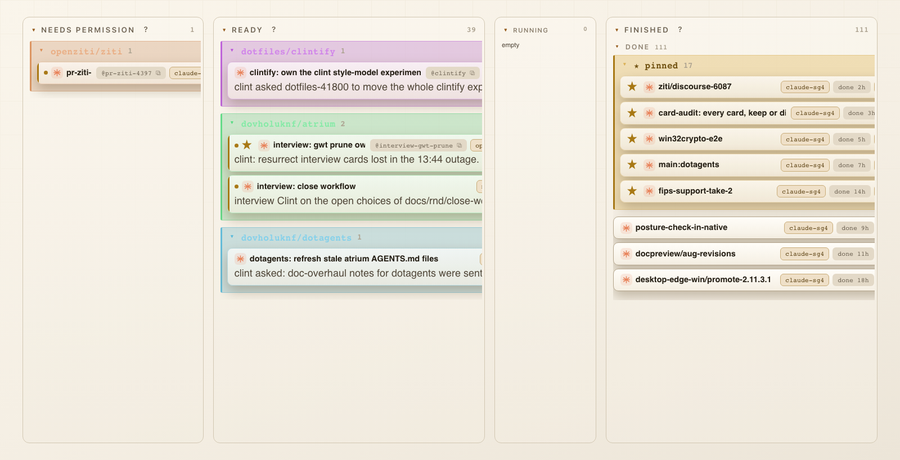
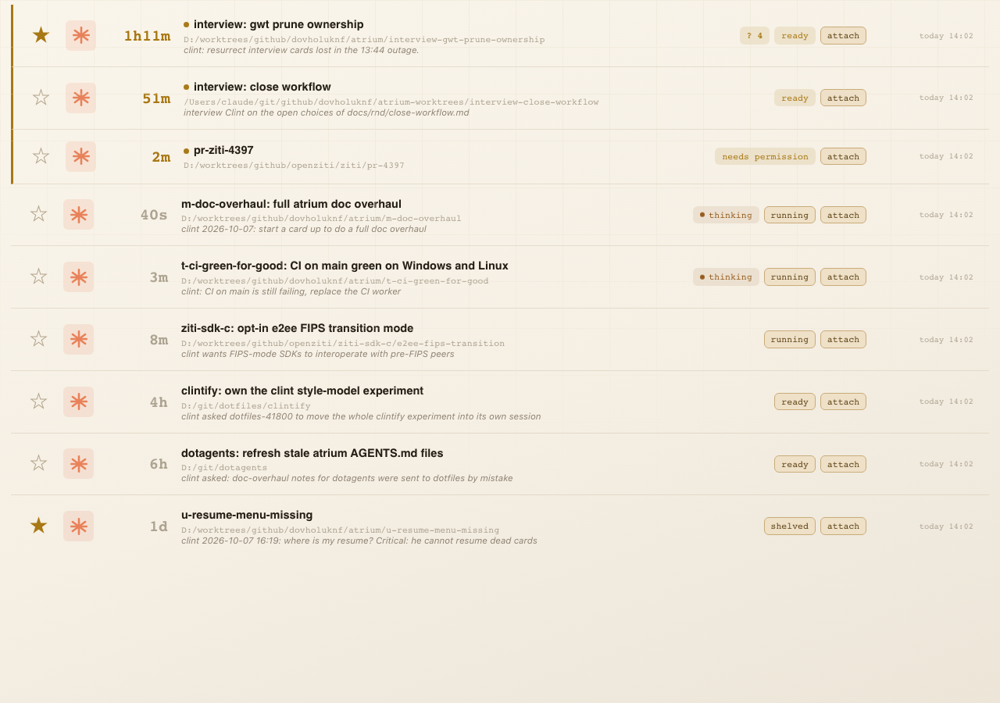
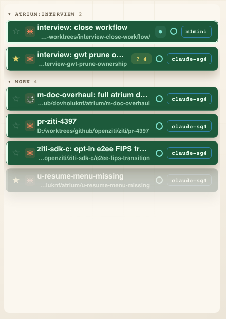
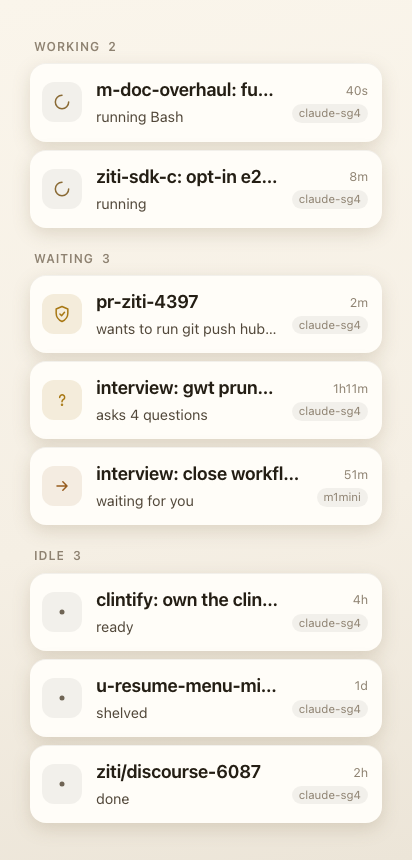
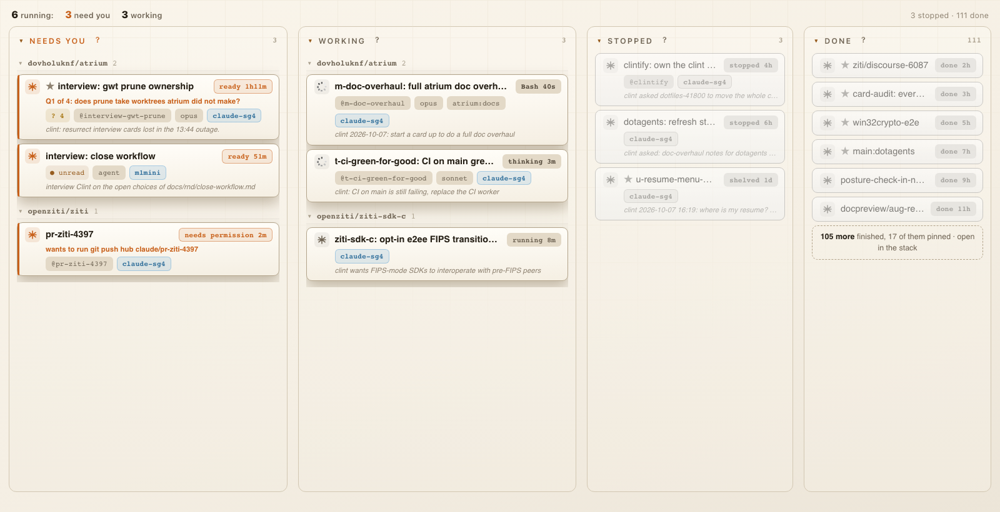
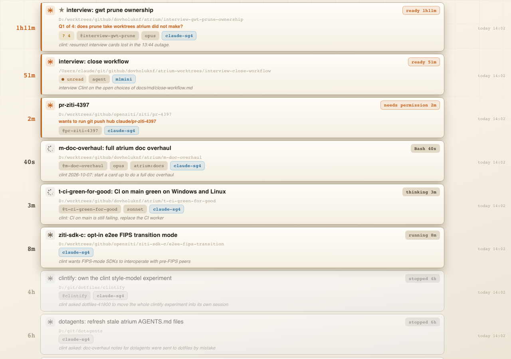
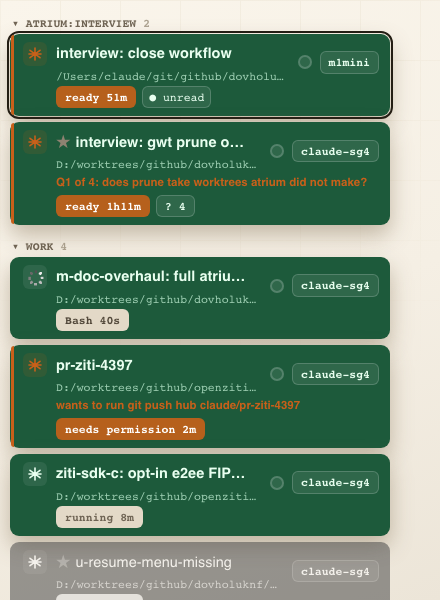
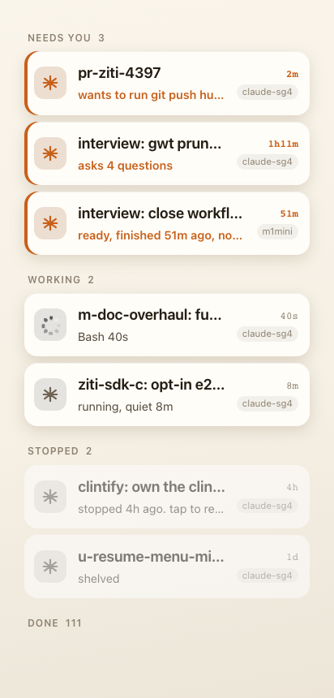

# One card everywhere (r-unified-card)

Status: design by r-unified-card, 2026-10-13. Nothing here is built. "Open choices" at the end lists what only clint
can settle, ranked, each written so an interviewer can ask it alone.

clint's fixed rules, not reopened here:

- **(a) Grey means NOT RUNNING and nothing else.**
- **(b) ONE running mark, everywhere.**
- **(c) A running card waiting for clint is ORANGE, whoever launched it.**

His complaints about the board (screenshot of 2026-10-13 16:23): the RUNNING column says 0 while cards run, FINISHED
has 111 rows with a pinned sub-group inside DONE, repo groups are coloured bands, and chips are cut off at the right
edge. He calls the board tab's presentation junk.

Read for this design: `internal/api/web/js/cardrules.js` (with `runnerGone` and `cardWaiting` from 839b365c, the
baseline), `js/core.js` (COLUMNS), `js/board.js` (cardHTML, renderBoard, the groups), `js/stack.js` (stackRow and the
chip builders the board borrows), `js/seen.js`, `js/terminal-list.js` (termRow), `js/themes.js` (the card wear),
`js/keepalive.js`, `m/js/home.js` and `m/m.css` (the phone), and `css/cards.css`, `css/rows.css`, `css/notify.css`.

## 0. The design in one paragraph

Every view draws a card with one function, `cardFace(t, layout)`, from one derived state, `cardState(t)`, which has
five values: **waiting** (orange), **working** (the runner mark spins, the one running mark), **live** (the skin's
own colours), **off** (grey, and the only grey) and **unreachable** (dashed, because nothing says it stopped). The
runner mark loses its orange so orange means one thing. A view keeps its layout and may add to the card in named
slots (the stack's big age and date track, the terminals list's room chip and keepalive mark), never change it. The
board's columns follow the state, not the stored status: **needs you**, **working**, **stopped**, **done**. RUNNING
becomes a count over the first two, so it can no longer read 0 while runners are alive. Done shows the recent few and
hands the rest to the stack. Groups become headings, not bands. Chips wrap onto a second line instead of being
clipped, and actions only appear on hover.

## 1. What each view draws today

### 1.1 The board (`cardHTML`, js/board.js:773)

- One line: title then a chip row (board.js:791-866). The chip row is `nowrap` with a hidden horizontal scrollbar
  (css/cards.css:254-260), so whatever does not fit is clipped with no mark. This is the "chips cut off".
- Waiting: `.card.waiting` paints a warn left edge (cards.css:239) plus an orange `.pulse` dot before the title
  (board.js:793) plus a warn state chip (board.js:812-817). Three marks for one fact.
- Not running: only `isOutOfContact` (board.js:752) greys a card, at `opacity .68` (cards.css:432), and only for
  status `running` with no pid after 20 minutes. It ignores `supervised`, `starting` and `offline`, so it is a second,
  different "is it gone" test beside `runnerGone`. A `needs-input` card whose runner is gone is not grey at all.
- Running: `activityChip` (board.js:517) draws a teal chip with an animated dot (cards.css:394-416). An idle activity
  is drawn in `--dimmest` (cards.css:414), grey on a live card.
- The claude runner mark is orange on every card (`.rmark[data-runner="claude"]`, css/rows.css:323), the same hue
  family as waiting. The shell runner's mark is `--warn` itself (rows.css:326).
- Columns are stored statuses (COLUMNS, js/core.js:34). `running` holds only status `running`, which a hook sets for a
  turn in progress. A turn that ends moves the card to `needs-input` (READY) whether or not its runner lives on. So
  RUNNING reads 0 whenever nobody is mid-turn, and READY holds both live cards waiting on clint and cards whose
  runner is long gone (39 in the screenshot). That is why the count is 0.
- Column width is `sqrt(count)` capped at 4 (board.js:1997). DONE with 111 cards earns the maximum, the widest column
  on the board for the cards that need nothing.
- Every column draws a pinned group first (`pinnedGroupHTML`, board.js:1572, called from `cardsHTML` :1590), so DONE
  holds a "pinned 17" block inside "done 111", inside FINISHED.
- Project groups are washed in a hue hashed from the name (`groupHue`, board.js:1423, cards.css:150-169) with a tint
  on every card inside (cards.css:163-169). These are the coloured bands.
- Actions `attach` and the pop-out icon are drawn on every supervised card at rest (board.js:855-860), taking chip
  width from facts.

### 1.2 The stack (`stackRow`, js/stack.js:526)

- Row: pin star, runner mark, a big age, name with path and why, chips, a date track (stack.js:526-588).
- Waiting: `.stackrow.attn` warn left edge (rows.css:80), the `.pulse` dot (stack.js:541), an orange big number, a
  warn state chip (`stateChip`, stack.js:594).
- Grey: `.wait.quiet` (stack.js:538, rows.css:88) greys the big number of every card that is not waiting, working
  ones included. That breaks rule (a): a card mid-turn reads as not running.
- Running: the same `activityChip` as the board, plus the state chip in the accent colour for `running`.
- No grey for a card whose runner is gone. A dead-runner `needs-input` card reads `ready` in the accent colour.
- The card wear (`cardWear`, js/themes.js:426) repaints a row in its terminal's palette and rewrites `--warn` to the
  theme's yellow (themes.js:460). On a worn row orange is not orange. The khaki rows in the 16:16 screenshot are this.

### 1.3 The terminals list (`termRow`, js/terminal-list.js:1048)

- Row: pin, runner mark, name over a dim path, right-side chips (`termRowChips`, :1206): stuck mark, new-card,
  context, seen chips, keepalive, a held message, the room chip (`termRoomChip`, :1238), popped-out, joined.
- Running: the runner mark is swapped for `working.gif` (`termRunnerMark`, :1015, rows.css:353). A folded parent draws
  a second spinner, `tkidspin` (:1158, css/sharing.css:495).
- Waiting: nothing. The comment at :1050 says amber was removed on purpose, because the row wears its terminal's
  theme. That breaks rule (c).
- Grey: `termCold` (:212) uses `runnerGone`, faded with `opacity .3` and `grayscale(.65)` (css/notify.css:160). This
  is the one view that already follows rule (a).
- The keepalive mark (`keepaliveChip`, js/keepalive.js:220) is a hollow or filled dot, and the unseen mark
  (`seenChips`, js/seen.js:25) is another dot. Two dots on the right of a row, neither of them the running mark.

### 1.4 The phone (`rowHTML`, m/js/home.js:210)

- Row: a 40px glyph per reason (`ICON`, home.js:18), name, a reason line, age and room on the right.
- Waiting: permission and questions are warn (m/m.css:130). **Ready, unseen and report are teal** (m.css:131). Rule
  (c) is broken for the commonest wait. On linen teal is brown, so it passes for orange by accident.
- Running: a spinning arc glyph in blue (`ICON.working`, m.css:133), a third running mark. Its "Working" section is
  status `running` (`groupOf`, home.js:188), the same 0 the board shows.
- Grey: `runnerGone` sends a card to "Idle" (home.js:189), and Idle also holds done, dead and shelved, all drawn
  with the same neutral dot. Nothing is grey, so nothing says which of those can be resumed.

### 1.5 Where they differ

| Fact | Board | Stack | Terminals | Phone |
| --- | --- | --- | --- | --- |
| waiting on clint | edge, pulse, warn chip | edge, pulse, orange age, warn chip | nothing | warn glyph for permission and questions, teal for ready |
| working | teal chip with animated dot | same chip | spinning runner mark | blue spinning arc |
| runner gone | grey only if status running and no pid | not drawn | grey (`termCold`) | "Idle", not grey |
| live but quiet | `--dimmest` idle chip | grey age | normal | "Working" |
| colour by repo | hued band and tint | none | theme wear | none |
| overflow | clipped | wraps | fixed set | one reason plus `+N` |
| room | in tags when present | in tags | room chip | room pill |






## 2. The shared card

### 2.1 One state

Added to `js/cardrules.js`, which the board and the phone both load, so there is one copy:

```js
// One word for how a card is drawn, everywhere. Grey is "off" and nothing else.
function cardState(t) {
  if (!t) return "off";
  if (t.offline) return "unreachable";
  if (cardWaiting(t)) return "waiting";
  if (cardLive(t)) return workingNow(t) ? "working" : "live";
  return "off";
}
function cardLive(t) {
  return !!t && (!!t.starting || (LIVE_STATUSES.includes(t.status) && !runnerGone(t)));
}
```

`workingNow` moves here from terminal-list.js:191, and `staleActivity` from core.js:189 with it. `isOutOfContact`
(board.js:752) is deleted: a running card with no pid past the no-contact window is already `runnerGone`
(cardrules.js:128), so it is off.

| State | Means | Drawn |
| --- | --- | --- |
| waiting | a live runner is waiting on clint: needs-input or needs-permission, whoever launched it | orange left edge, orange state chip, orange-tinted runner mark |
| working | a live runner is mid-turn (`workingNow`) | the runner mark spins. Nothing else moves |
| live | a live runner that is neither: status running but quiet, a looks-idle screen, starting | the skin's own colours. Not grey |
| off | no runner: gone, parked, shelved, done, dead, an inbox card | grey: `grayscale(1)` and `opacity .55` on the whole card |
| unreachable | its room is not answering | dashed outline, no fill change, the room chip says offline. Not grey, because nothing says it stopped |

### 2.2 The one orange

A new skin token, `--wait` (with `--wait-rgb`, `--wait-bg`, `--wait-stroke`), declared in css/tokens.css and in every
skin block of css/themes.css. It is used for the waiting state and nothing else. `--warn` stays for warnings (a
stuck clock, sha unverified, a held message), which are not "clint owes an answer".

- On linen `--warn` is mustard (168,120,20) and `--teal` is brown (150,92,30). The waiting orange cannot be either,
  or it reads as a warning or as a live chip. `scripts/check-contrast.js` holds `--wait` at 4.5:1 for text against
  `--card-0` in every skin, and a new check holds its hue at least 25 degrees from `--warn` and `--teal`.
- The card wear (`wearOf`, themes.js:441-470) never writes `--wait`. A worn row keeps its terminal's background and
  text, and the orange edge and chip stay the board's orange. A worn row also never greys itself: grey comes only
  from `.s-off`.

### 2.3 The one running mark

The runner mark with `working.gif` over it, as terminals draw it today (rows.css:353-379). Every view has a runner
mark, so every view can carry it.

- Removed: the animated dot in `.chip.live` (cards.css:397-416), the phone's spinning arc (`ICON.working`), and the
  folded parent's `tkidspin` (it becomes a plain count, `2 working`).
- `activityChip` keeps its words and drops its motion. What the session is doing (`Bash 40s`, `thinking 3m`,
  `compacting`) becomes the state chip's text for a working card, so the age chip and the activity chip are one chip.
- `looksIdleChip` (board.js:558) stays. It is a warning that the turn end never arrived, drawn on a live card, and
  it does not move.
- The header's `N working` (`paintWorking`, board.js:1785) counts `cardState === "working"`, the same test.

### 2.4 The runner mark is neutral

The per-runner colours (rows.css:323-326) go. The mark is `--label` on `--lift` for every runner and every state,
except waiting, where it takes `--wait`. A runner is told apart by its shape, which is what the shapes are for
(`RUNNER_MARKS`, stack.js:921). Without this, every claude card carries an orange asterisk and orange stops meaning
waiting.

### 2.5 Anatomy

```
 ┃ [mark] ★ title ........................................ [state chip]      line 1, never wraps
 ┃        path (stack and terminals only)                                      line 2
 ┃        ask, in orange, when there is one                                    line 3
 ┃        ? 4  ● unread  @alias  opus  tags  room  ...  [attach on hover]      chips, wrap
 ┃        why, italic, one line                                                why
```

- Line 1 holds the mark, the pin star, the title and the **state chip**. The title truncates. The state chip never
  does, so the age is always readable. The state chip is the status word and its age: `ready 51m`, `needs permission
  2m`, `Bash 40s`, `running 8m`, `stopped 4h`, `done 2d`. A question owed replaces the word (`asked you 3m`), as
  `stateChip` does today (stack.js:603).
- The chip line wraps. Nothing is clipped. The board's `nowrap` and hidden scrollbar go.
- Actions (`attach`, pop-out, `resume`, `start`, `unshelve`) are not drawn at rest. They show on hover and in the
  card menu, which a click already opens (`cardMenu`). The phone has no hover and never drew them.
- The `.pulse` dot goes. The orange edge and chip say waiting.

### 2.6 Chips, in order

Tier 1 is on every view and every layout. Tier 2 is on the board and the stack, and on the phone's card sheet.
Terminals draw tier 1 plus their own side slot.

| Tier | Chips, in this order | Source today |
| --- | --- | --- |
| 1 | state, `? N` questions, unread dot, blocker or stuck mark, looks idle, held message, `auto` | stateChip, seenChips, stuckMark, looksIdleChip, termHeldChip |
| 2 | subagents badge, alias, model, tags, note, origin, recap, context gauge and warn, room, shared, sha unverified, wake queued, new context, parked | board.js:796-866 and stack.js:768-895 |
| actions | attach, pop-out, resume, start, unshelve | hover only |

The keepalive mark leaves tier 2. It only matters when choosing which terminal to attach, so it is a terminals
addition (2.7). The `origin` chip stays, but rule (c) means it never changes the colour.

### 2.7 What a view may add

A view picks a layout and may add in named slots. It may not change the state colours, the mark, the chip order or
the grey.

| View | Layout | Adds |
| --- | --- | --- |
| board | `lane`: one card per row in a column | nothing |
| stack | `row`: the card between a big age on the left and a date track on the right | the big age (orange when waiting, `--body` when live or working, `--dimmest` only when off), the date track, the path line |
| terminals | `tab`: compact, state chip on the chip line so the title keeps its width | the path line, a side slot on the right with the keepalive mark and the room chip, the theme wear (background and text only), nesting under a parent |
| phone | `tap`: a 40px runner mark, the first reason as the line under the name, age and room on the right | the reason line, `+N` more reasons |

## 3. The board, redesigned



### 3.1 Columns follow the state

| Column | Holds | Order |
| --- | --- | --- |
| inbox | status `backlog`, hidden when empty (unchanged) | as today |
| **needs you** | `cardState === "waiting"`: permission first, then questions, then ready | longest wait first |
| **working** | `working` and `live` | activity |
| **stopped** | `off` and not over: runner gone, parked, shelved | most recent first |
| **done** | done and dead | most recent first, capped (3.3) |

The needs-permission and ready columns merge into **needs you**. A permission is still first in it, and its state
chip says `needs permission`. When auto mode is on, `needs you` still holds ready cards, so it never goes moot the
way the permission column does today (board.js:1937).

The stored statuses do not change. COLUMNS (core.js:34) gains a `holds(t)` predicate in place of `statuses`, built on
`cardState`, and the move-to menu files by `takes` as now (`needs you` and `working` keep `accepts: false`,
`stopped` takes `shelved`, `done` takes `done`).

### 3.2 Why RUNNING read 0, and what replaces it

Section 1.1: RUNNING was status `running`, a turn in progress. Clint reads "running" as "a runner is alive", which
is rule (a)'s meaning. So "running" stops being a column and becomes the count above the board:
**`6 running: 3 need you, 3 working`**, with `3 stopped · 111 done` at the right. Both numbers come from
`cardState`, so they cannot disagree with the columns.

### 3.3 Done with 111 rows

- Done is the record, not work. It draws the 6 most recent (any finished in the last 24 hours, at most 12), then one
  row, `105 more finished, 17 of them pinned · open in the stack`, which switches to the stack with only finished
  shown (the stack's `finished` pill exists). The header count stays the total, and `clear` stays.
- Done and stopped have a fixed width (`flex: 0 0 300px` and `0 1 330px`). The `sqrt(count)` weight (board.js:1997)
  counts only needs you and working, so the columns that need clint take the room.
- No pinned sub-group, in any column. A pin is the star on line 1 and a sort key: pinned cards come first inside their
  group. `pinnedGroupHTML` (board.js:1572) and the pin fold keys go. Where a pinned finished card goes is Open choice
  2.

### 3.4 Groups are headings

A project group is a heading line: a fold caret, the name in `--label` mono, the count in `--dimmest`, a hairline
under it. No fill, no hued border, no card tint. `groupHue`, `GROUP_HUES`, `pickGroupHue`, `setGroupHue` and the
recolor menu (board.js:1423-1570) go, with the `hues` field in the grouping prefs (board.js:1084). The stack's groups
and the terminals' `tgroup` headings take the same heading, so a group looks the same everywhere.

### 3.5 Overflow

Chips wrap (2.5) and actions are hover only, so nothing is clipped. A card with many tier-2 chips grows a line rather
than hiding one. A card with no tier-2 chips and no why is one line, the height it is today.

## 4. The other views, after



The stack keeps its row layout and its sorts and pills. Its rows become the shared card inside the big age and the
date track. A working card's age is `--body`, never grey.



The terminals list keeps its theme wear, its nesting and its side slot. A waiting row gets the orange edge and an
orange state chip whatever its theme. Grey stays `termCold`, now `cardState === "off"`.



The phone's glyph becomes the runner mark, which spins for working and goes orange for waiting. Ready is orange,
not teal. Its sections become **Needs you**, **Working**, **Stopped**, **Done** (folded), from the same `cardState`
the board uses. The "needs you" tab's reasons (`reasons`, home.js:46) are unchanged: they already skip `runnerGone`.

## 5. Changes, by file, with cost

| File | Change | Cost |
| --- | --- | --- |
| js/cardrules.js | `cardState`, `cardLive`, `workingNow` and `staleActivity` moved in | small |
| js/cardface.js (new) | `cardFace(t, layout, slots)`: the card markup, tier order, the state chip. Loaded by index.html and m/index.html. Takes the board-only chip builders as an optional `chips(t)` hook so the phone does not need stack.js | medium |
| js/board.js | `cardHTML` becomes `cardFace(t, "lane")`. Delete `isOutOfContact`, the pinned group, the hue code. Column bodies from `holds`. Done cap and the more row. Weight from live columns. The count line | medium |
| js/core.js | COLUMNS rewritten as 3.1 with `holds(t)`. Move-to menu reads `takes` as now | small |
| js/stack.js | `stackRow` wraps `cardFace(t, "row")`. `.wait.quiet` keyed on `off`. `stateChip` moves into cardface.js. Stack groups take the heading style | small |
| js/terminal-list.js | `termRow` uses `cardFace(t, "tab", {side})`. `termRunnerMark` moves to cardface.js. `tkidspin` becomes a count. `termCold` becomes `cardState === "off"` for drawing (the pinned and kept rules stay) | medium |
| js/themes.js | `wearOf` stops writing `--warn` and never writes `--wait` | small |
| js/seen.js, js/keepalive.js | no logic change. keepalive is called from the terminals side slot only | small |
| m/js/home.js | `rowHTML` uses `cardFace(t, "tap")`. `groupOf` and GROUPS from `cardState`. `ICON.working` goes | small |
| css/cards.css | the card grid (2.5), wrap, `.s-*` rules, heading-style groups, delete band, tint, pulse and the live-chip animation | medium |
| css/rows.css | neutral `.rmark`, orange only under `.s-waiting`, `.wait` colours per state | small |
| css/tokens.css, css/themes.css | `--wait` family in `:root` and every skin | small |
| m/m.css | `.s-*` on rows, delete the per-kind glyph colours | small |
| scripts/check-contrast.js | `--wait` contrast and hue distance in every skin | small |

Order: tokens and `cardState` first (nothing visible), then cardface.js with the stack (the simplest layout), then
the board, then terminals and the phone. Each step ships alone. The whole is about one large item, split in four.

## 6. Tests that prove it

Headless units in `scripts/test-board-headless.js`, one per rule, against the mocked daemon with one card per state:
a supervised working card, a live quiet running card, a ready card with a pid, a ready card launched by an agent
(`origin:agent`), a permission card, a ready card whose runner is gone (no pid, unsupervised), a parked card, a
shelved card, a done card, an offline card.

1. **greyOnlyOff**: on the board, the stack, the terminals list and the phone page, every card with
   `cardState === "off"` has a computed `filter` containing `grayscale` and no other card does. No element inside a
   non-off card has a computed colour equal to `--dimmest` except the path line and the date track.
2. **oneRunningMark**: in every view, the count of elements with an animation or the working gif equals the count of
   working cards, and each is a `.rmark.working`. No `.chip.live::before` animates, no `.tkidspin`, no `.spin` on the
   phone.
3. **waitingIsOrange**: every waiting card, the agent-launched one included, has a left edge and state chip whose
   computed colour is `--wait`, in every view and under a worn theme. No non-waiting card uses `--wait` anywhere.
4. **runnerMarkNeutral**: a live claude card that is not waiting draws its mark in `--label`.
5. **columnsFollowState**: the board's column counts equal the `cardState` counts, the dead-runner ready card is in
   stopped, and the count line's `running` equals needs you plus working.
6. **doneCapped**: with 111 done cards, done draws at most 12 cards and a more row naming 99 or more, and its width
   does not grow with the count.
7. **noBands**: no `.cardgroup` has a background other than transparent, and no card has a hue tint.
8. **noClip**: on a 268px column, every chip's right edge is inside its card (`getBoundingClientRect`), and the state
   chip is on the title's line.
9. **pinNoGroup**: no `.pins` group is drawn on the board. A pinned card is first in its group.
10. Node unit for `cardState` over the same fixtures, in `scripts/test-notify-rules.js` beside the existing
    `runnerGone` cases, so the rule is held without a browser.
11. `scripts/check-contrast.js`: `--wait` at 4.5:1 on `--card-0`, and 25 degrees of hue from `--warn` and `--teal`,
    in every skin.

`joinedLive` and `u002` keep passing unchanged: a joined live card is `live`, a cold pinned card is `off`.

## Open choices

Ranked by how much of the build each one changes. Each stands alone.

### 1. What are the board's columns?

Today the columns are stored statuses, so RUNNING reads 0 whenever nobody is mid-turn and READY holds cards whose
runner is gone. The question is what replaces them.

- **A. Needs you, working, stopped, done (recommended).** Columns follow whether a runner is alive and whether it waits
  on you. "Running" is the count above the board. Cost: the permission and ready columns merge, so a permission is a
  card at the top of needs you rather than a column of its own. About the build in section 5.
- **B. Running, stopped, done.** One column for every live card, waiting ones first and orange. Cost: a long running
  column mixes what needs you with what does not, and you scan for orange instead of reading a column.
- **C. Keep the status columns, fix the counts.** RUNNING counts live runners in its header, READY greys dead-runner
  cards. Cost: small, and READY still fills with grey cards, and the word "running" still means two things.

### 2. Where does a pinned card go once it is finished?

There are 17 pinned cards in DONE today. A pin means "keep this findable" and on the terminals list it keeps a row.

- **A. In done, first, under the same cap (recommended).** The star says pinned, the more row counts them ("17 of
  them pinned"). Cost: a pinned card older than the cap is one click away in the stack, not on the board.
- **B. Pinned finished cards sit in stopped.** You pinned them to come back to, which is what stopped is for. Cost:
  stopped stops meaning "the runner went away without being finished", and done never holds a pin.
- **C. Pins are exempt from the cap.** Cost: done is 17 rows again before anything recent shows, which is the
  complaint.

### 3. Does shelved belong in stopped?

Shelved is "put down on purpose" and refuses its requests. Stopped is "no runner, not finished".

- **A. Yes, with a `shelved` state chip (recommended).** Both are grey, both are resumed the same way. Cost: none
  beyond a chip. The column chip to hide them in the drawer stays.
- **B. Keep a shelved column.** Cost: a fifth column for a handful of cards, and two grey columns side by side.

### 4. Repo colour: gone, or kept as a mark?

Coloured bands are the complaint. The hue also tells two groups apart at a glance and you can recolor a group.

- **A. Gone everywhere (recommended).** Headings carry the name only. Cost: the recolor menu goes, and a card scrolled
  away from its heading no longer says its project by colour.
- **B. A small swatch beside the heading name, only for groups you recolored.** Cost: keeps the hue code and the
  recolor menu, and a coloured square is one more mark to learn.
