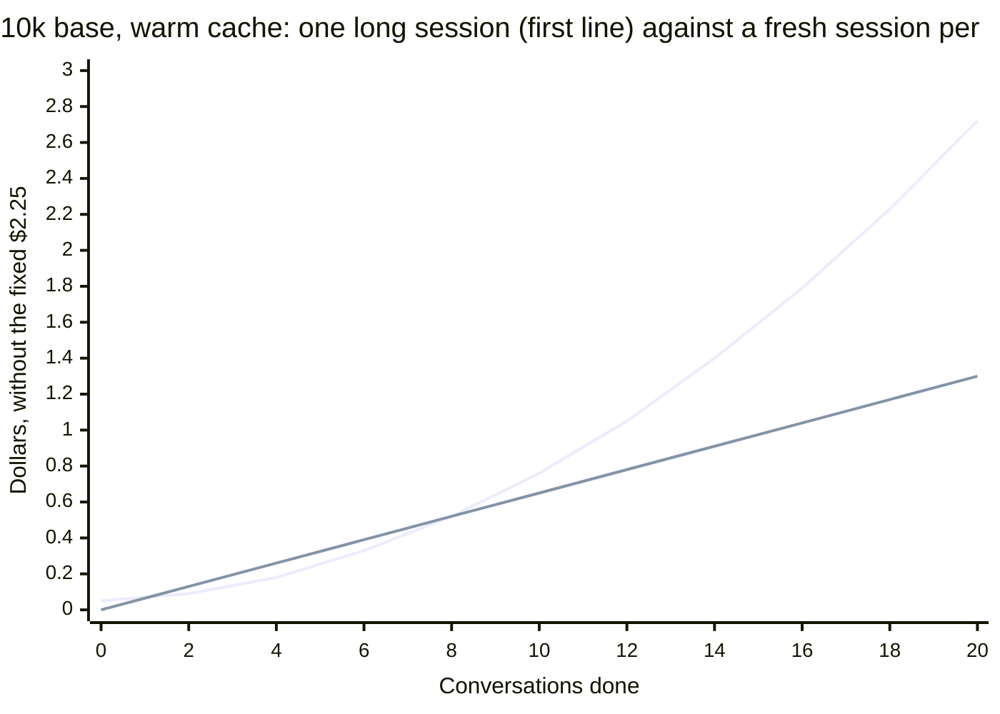
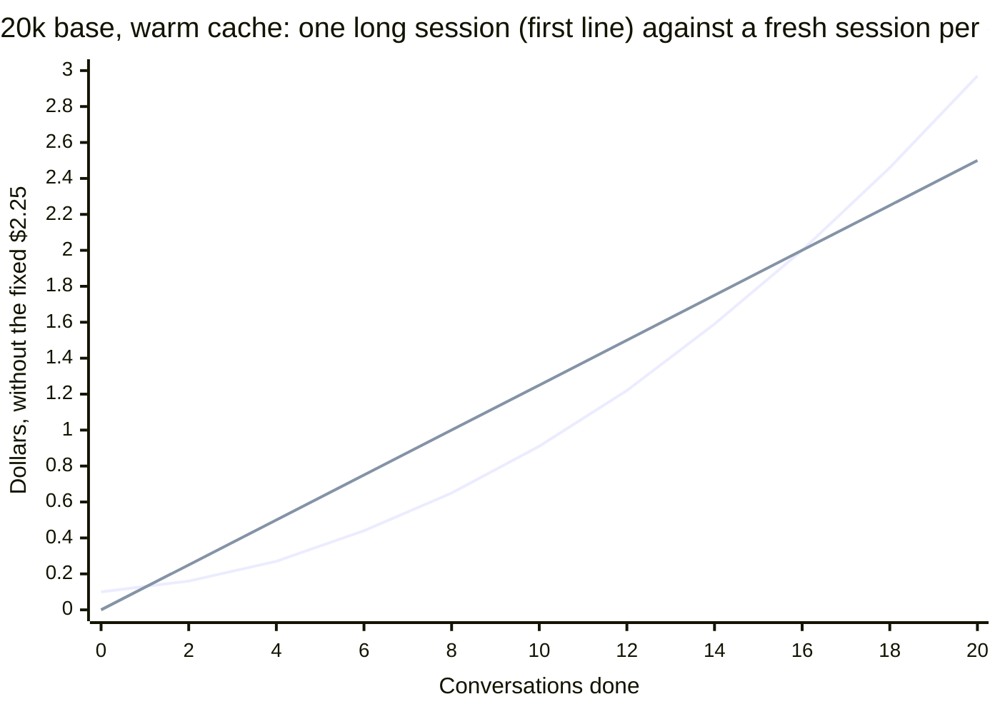
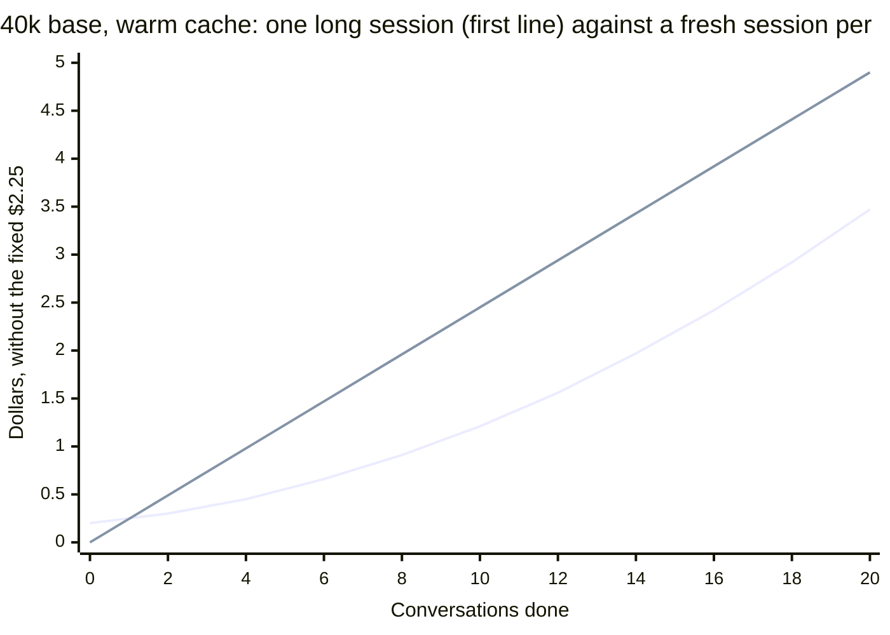
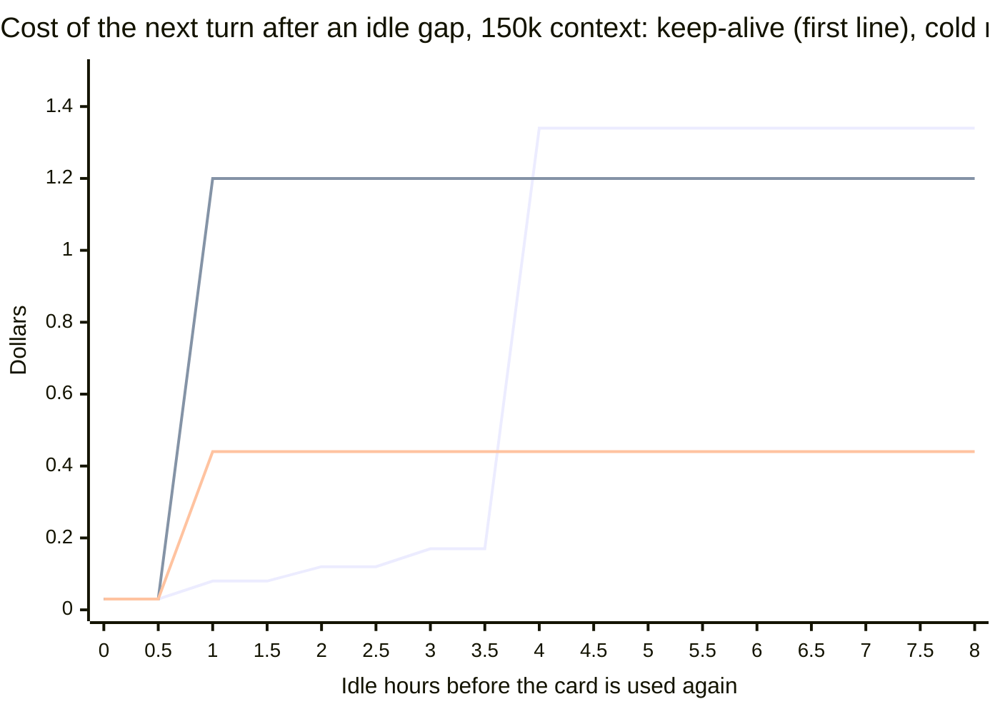

# What a Claude session costs, and what keeping its cache warm buys

The operator's question was how much the prompt cache matters. This doc builds a small model of Claude's billing,
answers the question with it, then measures atrium's keep-alive, its price tables and its new-context idea against the
model. Status: analysis, nothing in atrium's code changes with it. The changes it recommends are filed on the backlog,
listed in the last section.

Every number in a table or chart comes from `scripts/cost-model.js`, which holds the prices and assumptions at its top
and prints each block. `node scripts/cost-model.js --check` fails when a block in this file differs from its output.
Numbers in the prose were read off those blocks, except the ones marked as measured on this machine, which come from the
room's database and the pricing page.

## 1. The question

> I hear a lot about keeping the prompt cache warm, but I do not understand the impact. Model 20 conversations. Each
> conversation ends with the model performing five actions (bash, git, powershell, anything), and each action costs
> about 2,500 tokens. What are the cost differences if those twenty conversations:
>
> - start with 10k of context and all run in one Claude session
> - start with 20k of context and all run in one Claude session
> - start with 40k of context and all run in one Claude session
> - are split into two Claude sessions of 10 conversations each
> - are 20 separate sessions, starting with 10k, 20k or 40k of context
>
> Are there any holes in this matrix?

The short answer is that a cold cache is the expensive case by a wide margin, that separate sessions are immune to it,
and that the matrix has holes. Section 4 fills them.

## 2. The model

### Prices

Checked against https://platform.claude.com/docs/en/about-claude/pricing on 2026-10-20. Per million tokens.

<!-- cost-model:prices -->
| Model | Input | 5m write | 1h write | Cache read | Output |
| --- | --- | --- | --- | --- | --- |
| Opus 5.5 | $4.00 | $5.00 | $8.00 | $0.20 | $20.00 |
| Sonnet 5.5 | $2.00 | $2.50 | $4.00 | $0.10 | $10.00 |

Sonnet 5.5 is half of Opus 5.5 on every column. For both, a cache read is 0.05x the input price, a 5 minute write is
1.25x and a 1 hour write is 2x. Measured against a cache read, which is the unit that matters here:

<!-- cost-model:price-ratios -->
| Per million tokens, Opus 5.5 | Price | Against a cache read |
| --- | --- | --- |
| Cache read | $0.20 | 1x |
| Plain input | $4.00 | 20x |
| 5m cache write | $5.00 | 25x |
| 1h cache write | $8.00 | 40x |
| Output | $20.00 | 100x |

### What a call costs

Every call resends the whole context. Caching changes what the resend costs. A cache hit is $0.20 per million, a write
is $5 per million (25 times as much) and output is $20 per million. The 5 minute cache gets another 5 minutes each time
it is hit. Idle for longer and the next call writes the whole context again at 25 times the price of reading it. That
rewrite is what "keeping the cache warm" protects against.

### Assumptions

<!-- cost-model:assumptions -->
| Assumption | Value |
| --- | --- |
| Conversations, calls in each | 20, 5 |
| New tokens per call, written at the write price | 2500 |
| Output per call, at the output price | 500 |
| Fixed cost of the new tokens, 5m cache | $2.25 |
| Fixed cost of the new tokens, 1h cache | $3.00 |
| Keep-alive fork tail written, output | 2000, 10 |
| Keep-alive margin, cache lifetime, budget | 5 min, 60 min, 0.125 of one wake |
| Fresh context: base, handoff, rediscovery | 20k, 5k, 30k (55k written) |

Each action is one call that adds 2,500 tokens to the context, 500 of them output. There are 100 calls in every
scenario, so the new tokens cost the same everywhere: 2,500 written at the write price plus 500 output tokens. Only two
things differ between scenarios. One is the cache reads of the history that builds up, and the other is the cache
writes at each fresh start. For a session of n calls starting at C0 tokens, the reads are the sum over k from 0 to n-1
of (C0 + 2,500k).

### The matrix

The cold column assumes more than 5 minutes of idle time between every pair of conversations, so each conversation after
the first rewrites the whole history. The last column assumes the starting context is already in the cache from an
earlier session. That is an upper bound, section 4 says how much of a start is really shared.

<!-- cost-model:matrix-5m -->
| Scenario | Warm cache | Cold (over 5 min idle between conversations) | Warm, base context shared across sessions |
| --- | --- | --- | --- |
| 1 session, 10k start | $4.98 | $17.29 | n/a |
| 1 session, 20k start | $5.23 | $18.45 | n/a |
| 1 session, 40k start | $5.73 | $20.77 | n/a |
| 2 sessions x 10, 10k start | $3.78 | $10.04 | $3.73 |
| 2 sessions x 10, 20k start | $4.08 | $11.20 | $3.98 |
| 2 sessions x 10, 40k start | $4.68 | $13.53 | $4.48 |
| 20 separate, 10k start | $3.55 | $3.55 | $2.64 |
| 20 separate, 20k start | $4.75 | $4.75 | $2.93 |
| 20 separate, 40k start | $7.15 | $7.15 | $3.50 |

The script reproduces the draft figures for every cell but one. The 2 sessions x 10, 40k start cell with a shared base
is $4.48, not $4.47.

### Findings

- **A cold cache costs the most.** A long session with breaks between conversations costs 3.5 to 4 times as much as the
  same session kept warm, because each break writes the history again, up to 250k tokens, at $5 per million.
- **Separate sessions are immune to idle time.** Each pays only its starting write. With a 40k start that write ($0.20,
  20 times) costs more than the history a long session rereads, so 20 separate sessions at 40k cost $7.15 against $5.73
  for one warm session. They win only when the base is shared or the starts are small.
- **Break-even, warm.** Restart when H x (calls left) x $0.20 is more than $5 x base, that is H x (calls left) > 25 x
  base, where H is the history beyond the base. At 5 calls per conversation that is history past 5 times the base.
- **Break-even, cold.** Resuming writes base plus history again, a fresh start writes only the base. Fresh wins whenever
  the history exceeds what the new session must reread to catch up. That is almost always.
- **Cheapest is separate sessions with a shared prefix.** Claude Code's system prompt, tools and CLAUDE.md are the same
  each session, so a session started within the cache lifetime of the last one hits on that prefix.

### Cumulative cost, one long session against a fresh session per conversation

Warm, 10k start, without the fixed $2.25.

<!-- cost-model:cumulative -->
| Conversations done | One long session | Fresh per conversation |
| --- | --- | --- |
| 4 | $0.19 | $0.26 |
| 8 | $0.52 | $0.52 |
| 12 | $1.06 | $0.78 |
| 16 | $1.79 | $1.04 |
| 20 | $2.73 | $1.30 |

The long session grows with the square of the conversations because every call rereads all of the history. Fresh
sessions grow in a straight line.

<!-- cost-model:chart-cumulative-10k -->

The lines cross at conversation 8. A restart is worth it from conversation 4 on, in the sense that one more
conversation costs more than starting over, and the savings have paid back the early lead by 8.

<!-- cost-model:chart-cumulative-20k -->

The lines cross at conversation 16. History worth a restart is 100k, which takes 8 conversations to build.

<!-- cost-model:chart-cumulative-40k -->

The lines do not cross inside 20 conversations. History worth a restart is 200k, which is conversation 16, and the
savings from there do not make up the lead a long session has from paying the 40k start once.

<!-- cost-model:break-even-5m -->
| Base context | History worth a restart | Conversations to reach it | Cumulative cost equal at conversation |
| --- | --- | --- | --- |
| 10k | 50k | 4 | 8 |
| 20k | 100k | 8 | 16 |
| 40k | 200k | 16 | never within 20 |

## 3. Atrium against the model

### 3.1 The 1 hour cache

Atrium pins the main conversation of a keep-alive card to the 1 hour cache with `CLAUDE_CODE_PROMPT_CACHE_TTL=1h`
(`internal/daemon/keepalive.go:1235-1236`). The write price becomes $8 per million, 40 times a read. The model again,
with
the cold column meaning an idle gap of more than an hour between conversations:

<!-- cost-model:matrix-1h -->
| Scenario | Warm cache | Cold (over 1 hour idle between conversations) | Warm, base context shared across sessions |
| --- | --- | --- | --- |
| 1 session, 10k start | $5.76 | $25.76 | n/a |
| 1 session, 20k start | $6.04 | $27.52 | n/a |
| 1 session, 40k start | $6.60 | $31.05 | n/a |
| 2 sessions x 10, 10k start | $4.59 | $14.76 | $4.51 |
| 2 sessions x 10, 20k start | $4.95 | $16.53 | $4.79 |
| 2 sessions x 10, 40k start | $5.67 | $20.06 | $5.35 |
| 20 separate, 10k start | $4.90 | $4.90 | $3.42 |
| 20 separate, 20k start | $6.70 | $6.70 | $3.74 |
| 20 separate, 40k start | $10.30 | $10.30 | $4.37 |

How the conclusions move:

<!-- cost-model:ttl-compare -->
| Scenario | 5m, warm | 5m, cold | 1h, warm | 1h, idle past the hour | 5m cold over 1h warm |
| --- | --- | --- | --- | --- | --- |
| 1 session, 10k start | $4.98 | $17.29 | $5.76 | $25.76 | 3.0x |
| 1 session, 20k start | $5.23 | $18.45 | $6.04 | $27.52 | 3.1x |
| 1 session, 40k start | $5.73 | $20.77 | $6.60 | $31.05 | 3.1x |

- **A gap between 5 minutes and an hour stops costing anything.** The common human pause is exactly that. One session
  with breaks goes from $17.29 on the 5 minute cache to $5.76 on the 1 hour cache, 3.0 times cheaper, and that is the
  case the pin exists for.
- **Everything that writes gets dearer.** New tokens cost $3.00 per 100 calls instead of $2.25, and each start writes at
  1.6 times the price. A warm long session is 16 percent dearer ($4.98 to $5.76). Twenty separate sessions are 38
  percent
  dearer ($3.55 to $4.90), so the pin penalises exactly the pattern that was immune to idle time.
- **A real miss hurts more.** Past the hour a cold wake writes at $8, so the cold column grows by about half ($17.29 to
  $25.76). It happens less often because it needs an hour of idle time.
- **The break-even moves from 5 times the base to 8 times.** A restart is worth it only with history past 80k at a 10k
  base, 160k at 20k and 320k at 40k.

<!-- cost-model:break-even-1h -->
| Base context | History worth a restart | Conversations to reach it | Cumulative cost equal at conversation |
| --- | --- | --- | --- |
| 10k | 80k | 7 | 13 |
| 20k | 160k | 13 | never within 20 |
| 40k | 320k | 26 | never within 20 |

- **A shared prefix is easier to hit.** The next session has an hour to start, not 5 minutes.
- **The pin is a bet on a pause.** One pause of more than 5 minutes at 100k context costs $0.48 to rewrite on the
  5 minute cache. The pin pays $3 more per million tokens written, so it has to save about one such pause for every
  160k tokens a session writes.

### 3.2 Is the keep-alive policy right

The keep-alive refreshes an idle card's cache with a forked headless resume five minutes before the hour is up, and
stops when the spend since the card went idle reaches one eighth of one cold wake. The question is whether the margin,
the minimum context and the stop rule are the right numbers, and whether refreshing beats the alternatives.

**What a refresh costs.** One read of the whole context, plus the fork's own tail and reply. The fork writes about 2,000
tokens at the 1 hour price and answers "OK", which is $0.016 whatever the context. The design doc counts that tail as
"about 300 tokens of overhead", and the ledger says otherwise. Measured on this machine, 75 warmed refreshes averaged
187k tokens of context and $0.054 each, while a read of 187k is $0.037. The tail is the other $0.017.

**What the three choices cost.** For a card that has gone idle and will be used again, the options are to keep it warm,
to let it go cold and resume, or to start a fresh context with a handoff. A cold wake writes the whole context. A fresh
context writes only its base, the handoff and what the new session reads to find its feet, assumed here at 20k, 5k and
30k. That is 55k written, $0.44 on Opus 5.5.

<!-- cost-model:refresh-cost -->
| Context | One read | One refresh | One cold wake | Budget (1/8 wake) | Refreshes the rule allows | Best count with the tail | Best count without it |
| --- | --- | --- | --- | --- | --- | --- | --- |
| 50k | $0.010 | $0.026 | $0.40 | $0.050 | 2 | 1 | 5 |
| 100k | $0.020 | $0.036 | $0.80 | $0.100 | 3 | 3 | 5 |
| 150k | $0.030 | $0.046 | $1.20 | $0.150 | 3 | 4 | 5 |
| 200k | $0.040 | $0.056 | $1.60 | $0.200 | 3 | 4 | 5 |
| 300k | $0.060 | $0.076 | $2.40 | $0.300 | 4 | 4 | 5 |
| 430k | $0.086 | $0.102 | $3.44 | $0.430 | 4 | 4 | 5 |

<!-- cost-model:refresh-ev -->
| Context | N=1 | N=2 | N=3 | N=4 | N=5 | N=8 |
| --- | --- | --- | --- | --- | --- | --- |
| 1M tokens, no tail | $0.95 | $1.16 | $1.36 | $1.46 | $1.48 | $1.43 |
| 1M tokens | $0.93 | $1.13 | $1.32 | $1.40 | $1.42 | $1.33 |
| 150k | $0.13 | $0.14 | $0.16 | $0.16 | $0.16 | $0.11 |
| 50k | $0.03 | $0.03 | $0.03 | $0.02 | $0.01 | -$0.03 |

The last three columns of the first table say how many refreshes the stop rule allows, how many are worth having when
the tail is counted, and how many the design counted when it did not. The second table is the expected saving per
idle stretch from refreshing N times, using the 597 stretches past one hour that the design measured. It reproduces the
design's $1.48 per million tokens at N=5 on the first row. With the tail counted the best count falls to 1 at 50k, 3 at
100k and 4 from 150k up.

- **The margin is right.** A refresh is due 5 minutes before the hour is up, so one fires every 55 minutes instead of
  every 60, which is 9 percent more refreshes per hour kept warm. A refresh that arrives late costs a whole cold wake,
  $1.20 at 150k, against $0.046 for one that arrives early. The margin covers the one minute tick, the two minute fork
  timeout and a retry. Shortening it saves cents.
- **The minimum context is about right.** At 50k a cold wake is $0.40 and a refresh $0.026. The whole option is worth
  $0.03
  per stretch at one refresh and N=8 loses $0.03, so the 50k floor is the lowest that makes sense. Nothing is gained by
  moving it unless the tail grows.
- **The stop rule is within one refresh of the best.** The rule allows 2, 3, 3, 3, 4 and 4 refreshes from 50k to 430k
  where the best counts are 1, 3, 4, 4, 4 and 4. Its pre-send check prices a refresh as a read of the context and leaves
  out the tail, so it allows one refresh too many at 50k. It stops one early at 150k and 200k. The cost of both
  mistakes is under $0.02 per stretch. The rule is fine, but its arithmetic should count the tail.

**Return chance decides whether it pays.** A refresh buys something only if the card is used again inside the window it
extends. The refreshes are paid for every stretch and earn their keep only on the ones that come back.

<!-- cost-model:break-even-fresh -->
| Context | Refreshes | Warm until | Refresh spend | Cold wake | Fresh context | Return chance that pays for the refreshes | Return chance on this machine |
| --- | --- | --- | --- | --- | --- | --- | --- |
| 50k | 2 | 2.83 h | $0.05 | $0.40 | $0.44 | 13% | 19% |
| 100k | 3 | 3.75 h | $0.11 | $0.80 | $0.44 | 26% | 23% |
| 150k | 3 | 3.75 h | $0.14 | $1.20 | $0.44 | 34% | 23% |
| 200k | 3 | 3.75 h | $0.17 | $1.60 | $0.44 | 42% | 23% |
| 300k | 4 | 4.67 h | $0.30 | $2.40 | $0.44 | 80% | 26% |
| 430k | 4 | 4.67 h | $0.41 | $3.44 | $0.44 | 115% | 26% |

On this machine 23 percent of the stretches past one hour resumed inside the 3.75 hour window of a 150k card, and 51
percent had not resumed inside 30 hours, so the refreshes spent on them bought nothing. A 150k
refresh run spends $0.139 and saves $1.17 on a return. It needs a return chance of 12 percent against a cold wake and
34 percent when the alternative is a fresh context. The population here is every Claude Code session on one machine. An
orchestrator that an operator
returns to is different, and its chance is much higher.

**Idle time.** The three options for one 150k card, by how long it sits before its next turn.

<!-- cost-model:idle-table -->
| Idle gap | Keep-alive, then cold resume | Cold resume only | Fresh at the hour | Keep-alive, then fresh |
| --- | --- | --- | --- | --- |
| 0.5 h | $0.03 | $0.03 | $0.03 | $0.03 |
| 1 h | $0.08 | $1.20 | $0.44 | $0.08 |
| 2 h | $0.12 | $1.20 | $0.44 | $0.12 |
| 3 h | $0.17 | $1.20 | $0.44 | $0.17 |
| 4 h | $1.34 | $1.20 | $0.44 | $0.58 |
| 5 h | $1.34 | $1.20 | $0.44 | $0.58 |
| 8 h | $1.34 | $1.20 | $0.44 | $0.58 |
| 24 h | $1.34 | $1.20 | $0.44 | $0.58 |

<!-- cost-model:chart-idle -->

Under the chart, the break-even points at 150k:

- At 55 minutes the keep-alive fires its first refresh and parts from the cold-resume line. Up to 55 minutes all three
  options cost one read.
- Between 1 hour and 3.75 hours keep-alive is the cheapest, $0.08 to $0.17 against $0.44 for a fresh context and
  $1.20 for a cold wake.
- At 3.75 hours the stop rule has spent its three refreshes and the cache goes cold, so the next turn costs $1.34,
  more than a plain cold wake because the refreshes were spent for nothing. A fresh context at that point costs
  $0.44.
- A fresh context beats a cold wake whenever the card holds more than 55k tokens, the size the fresh context writes.
- Refreshing for long enough to cost one fresh context takes 9.5 refreshes at 150k, about 8.7 hours, which the stop
  rule never allows.

<!-- cost-model:winner-grid -->
| Context | 0.5 h | 2 h | 4 h | 8 h | 24 h |
| --- | --- | --- | --- | --- | --- |
| 50k | keep-alive = cold resume | keep-alive | cold resume | cold resume | cold resume |
| 100k | keep-alive = cold resume | keep-alive | fresh | fresh | fresh |
| 150k | keep-alive = cold resume | keep-alive | fresh | fresh | fresh |
| 200k | keep-alive = cold resume | keep-alive | fresh | fresh | fresh |
| 300k | keep-alive = cold resume | keep-alive | keep-alive | fresh | fresh |
| 430k | keep-alive = cold resume | keep-alive | fresh | fresh | fresh |

**Expected cost per stretch.** Weighting the return times by the 597 measured stretches, and counting the refreshes
spent
on the ones that never came back:

<!-- cost-model:policy-ev -->
| Context | Cold resume only | Keep-alive, then cold resume | Keep-alive, then fresh | Fresh at expiry, no keep-alive |
| --- | --- | --- | --- | --- |
| 50k | $0.196 | $0.168 | $0.180 | $0.216 |
| 100k | $0.393 | $0.299 | $0.210 | $0.216 |
| 150k | $0.589 | $0.428 | $0.239 | $0.216 |
| 200k | $0.785 | $0.556 | $0.268 | $0.216 |
| 300k | $1.178 | $0.795 | $0.372 | $0.216 |
| 430k | $1.688 | $1.116 | $0.468 | $0.216 |

Keep-alive beats a cold resume at every size, saving $0.16 at 150k, 27 percent. That is the case the design made and it
holds. But a fresh context at expiry, which costs nothing for the stretches that never return, is cheaper than
keep-alive followed by a fresh context above 111k tokens. How much cheaper depends on what a fresh start must
rediscover,
which is an assumption:

<!-- cost-model:policy-sensitivity -->
| Context | Rediscovery | Fresh context | Cold resume only | Keep-alive, then cold | Keep-alive, then fresh | Fresh at expiry |
| --- | --- | --- | --- | --- | --- | --- |
| 150k | 10k | $0.28 | $0.589 | $0.428 | $0.199 | $0.137 |
| 150k | 30k | $0.44 | $0.589 | $0.428 | $0.239 | $0.216 |
| 150k | 60k | $0.68 | $0.589 | $0.428 | $0.299 | $0.334 |
| 150k | 100k | $1.00 | $0.589 | $0.428 | $0.378 | $0.491 |
| 300k | 10k | $0.28 | $1.178 | $0.795 | $0.337 | $0.137 |
| 300k | 30k | $0.44 | $1.178 | $0.795 | $0.372 | $0.216 |
| 300k | 60k | $0.68 | $1.178 | $0.795 | $0.424 | $0.334 |
| 300k | 100k | $1.00 | $1.178 | $0.795 | $0.493 | $0.491 |

The fresh context wins at 150k while rediscovery stays under about 42k, which is between the 30k and 60k rows, and
at 300k while it stays under about 101k.

**What the ledger shows.** The keep-alive ledger on this machine holds 87 refreshes between 2026-09-28 and 2026-09-30,
which is where the database ends. 75 were warmed and cost $4.07. Of the 12 recorded as misses, 4 read more than 99
percent of the context and were stopped by the first version's 5 percent write rule, which the design dropped the same
week. The other 8 were real misses that read under 20 percent of the context and wrote nearly all of it. They cost
$9.25, 68 percent of the ledger's $13.53 for 9 percent of its refreshes. Four of the eight, on four different cards,
read
exactly 12,147 tokens, which looks like the prefix every card shares. A miss cost $1.16 on average against $0.054 for a
warmed refresh, 21 times as much. The stop rule cannot catch one before it happens, since it prices the next refresh as
a read. Whether misses still happen after
2026-09-30 is not in this data.

**Verdict.** The keep-alive is right against a cold resume and its margin, floor and stop rule are close to optimal.
Three things are off. The stop rule ignores the fork's tail, misses are the largest line in the ledger and no later data
says they stopped, and above about 110k of context a fresh start at expiry beats refreshing unless the operator is
likely to come back. The next section covers the last one.

### 3.3 Atrium's prices and cost figures

Checked against the pricing page on 2026-10-20.

| Where | What | Verdict |
| --- | --- | --- |
| `internal/daemon/keepalive.go:109-112` | Opus 5.5 `{4, 5, 8, 0.20, 20}` and Fable 5.1 `{10, 12.5, 20, 0.25, 50}` | correct |
| `internal/daemon/keepalive.go:98` | price table version `usageprices-2026-09-27` | stale name, nothing wrong with the values |
| `internal/daemon/usage.go:66-67` | Haiku 4.5 `{1, 1.25, 2, 0.10, 5}` and Sonnet 5 `{2, 2.5, 4, 0.20, 10}` | correct |
| `internal/daemon/usage.go:70` | Sonnet 5.5 cache read `0.20` | **wrong, the page says `0.10`** |
| `internal/daemon/usage.go:64` and `:68-69` | comments "a read 0.1 times, on both" and "Sonnet 5.5 costs what Sonnet 5 does" | wrong for Sonnet 5.5, whose read is 0.05x |
| `internal/hubstore/schema.go:808` | the hub's seed row for `claude-sonnet-5-5`, `0.20` | **wrong, same error, and the migration is `INSERT OR IGNORE` so a fixed seed does not reach an existing hub** |
| `internal/tokenprice/tokenprice.go:246` | `Defaults` row for `claude-sonnet-5-5`, `0.20` | **wrong, same error** |
| `internal/api/web/js/items-mock.js:18` | mock shows Sonnet 5.5 "cache write 1h / read $4 / $0.20" | wrong, mock data only |
| `internal/api/web/js/usage.js:63` | tooltip "0.1x the input price, less on some models" | true as written, vague for the two 5.5 models |
| `internal/daemon/usage.go:76-90` | a model with no row is `?`, and counted at zero in a sum | see below |

The Sonnet 5.5 error flows to every dollar figure that prices Sonnet 5.5 tokens: the usage rows and turn costs
(`internal/daemon/usage.go`, `internal/daemon/turncost.go:131`), the worker budget check
(`internal/daemon/workerpolicy.go:90`), the PR review cost (`internal/daemon/prrunner.go:868`, which also uses
Sonnet 5.5 as its fallback price) and the hub's item costs (`internal/link/workcost.go`). Sonnet 5.5 is the default
worker model. On this machine's database the 3,624 Sonnet 5.5 usage rows, priced from
their tokens, come to:

<!-- cost-model:measured-sonnet -->
| Model | At atrium's table | At the pricing page | Overstated by |
| --- | --- | --- | --- |
| Opus 5.5 | $1982.84 | $1982.84 | $0.00 |
| Sonnet 5.5 | $1001.79 | $725.25 | $276.54 |

The same tokens at the correct price are 28 percent lower. A worker budget that stops a card at a dollar figure stops
a Sonnet 5.5 card at about 72 percent of the spend it was meant to allow.

Prices the page lists that atrium has no row for: Opus 5 and Opus 4.5 to 4.8 ($5 input, $6.25 and $10 writes, $0.50
read, $25 output), Sonnet 4 to 4.6, Fable 5 (read at $1), Mythos and Haiku 5.5, which is priced by
prompt length and so needs a tier by context, not one row. A model with no row shows `?` in a total and is counted at
zero in `cardSpendUSD`, so a worker on Opus 5 or 4.7 never reaches its dollar budget. This machine's usage rows hold 54
Opus 5 rows, 14 Opus 4.7 rows and 4 Haiku 5.5 rows with no price.

Not wrong, but not seen by the model: the keep-alive only knows Opus 5.5 and Fable 5.1, because their cache key ignores
the effort level. Sonnet 5.5 has the same 1 to 40 read to write ratio as Opus 5.5, so the arithmetic of section 3.2
applies to it at half the dollars, and the board's skip reason says it "keys its cache on effort", which nobody has
checked for that model.

The 1 hour pin has its own price. Cards launched with the keep-alive switch on are pinned, and the switch defaults on,
so launched workers pay 1.6 times the write price to be able to idle. Measured on this machine, the premium over the
5 minute price is:

<!-- cost-model:measured-pin -->
| Model | Tokens written at the 1h price | Premium over the 5m price |
| --- | --- | --- |
| Opus 5.5 | 78.4M | $235.09 |
| Sonnet 5.5 | 70.0M | $105.06 |

That is gross. Each pause of more than 5 minutes would have cost a rewrite on the 5 minute cache. The workers' pause
pattern decides which is cheaper, and nobody has measured it.

### 3.4 f-fresh-context-after-idle

The item proposes a fresh context instead of a cold resume once a card has idled past its cache lifetime, with a
handoff atrium builds from its own state for an orchestrator that has no Write tool. Judged against the model:

- **It beats a cold resume outright above 55k tokens.** A cold resume writes the whole context, a fresh start writes
  base, handoff and rediscovery. At 150k that is $0.44 against $1.20, and it grows to $0.44 against $3.44 at 430k. The
  handoff costs no model call, because atrium builds it, so it is also available when the old cache is gone, where a
  model-written handoff would first have to pay for a cold wake.
- **It also shrinks every later call.** The resumed card reads 150k on each call and the fresh one reads 55k.
  Over ten later calls that saves $0.19 at 30k of rediscovery, and less as rediscovery grows:

<!-- cost-model:fresh-rediscovery -->
| Rediscovery tokens | Fresh context written | Cost | Saved reading 10 later calls at 150k |
| --- | --- | --- | --- |
| 10k | 35k | $0.28 | $0.23 |
| 30k | 55k | $0.44 | $0.19 |
| 60k | 85k | $0.68 | $0.13 |
| 100k | 125k | $1.00 | $0.05 |
- **It beats the keep-alive only for some cards.** With a refresh budget of three, keep-alive needs a return chance of
  26 percent at 100k, 34 percent at 150k, 42 percent at 200k and 80 percent at 300k to pay for itself against a fresh
  start. The saving from a hit is capped by what a fresh start would have cost, so refreshing a bigger context earns
  no more and costs more. This machine's population returns inside the window 23 to 26 percent of the time. At 150k and
  30k of rediscovery a fresh start at expiry costs $0.216 per stretch against $0.239 for keep-alive then fresh.
- **Keep-alive still wins for a card the operator is sure to come back to.** Orchestrators are the case. The more
  likely the return, the closer the refresh run gets to its full saving of $1.17 at 150k, against a cost of $0.139
  whatever happens.
- **It does not help a card idle for under an hour**, a card under 55k, or work whose state cannot be rebuilt from
  atrium's records. The model cannot price the second part. A handoff built from items, backlog entries, workers and
  says does not carry what the model had worked out and never wrote down. Rediscovery is the number that decides it,
  and 30k is an assumption.

Recommendation: build it, offer first and not automatic, and measure rediscovery before making it the default. The
cheapest policy in the model is keep-alive for cards the operator returns to, a fresh context once the window closes
for the rest, and no keep-alive at all for a big card nobody is waiting on. Two small items make that measurable.

## 4. Holes in the matrix

The matrix has holes. Each is a way the real cost departs from the model, with what atrium sees.

**Idle gaps.** The matrix has only "always warm" and "always cold at 5 minutes". The real gaps are in between. A pause
of 5 to 60 minutes is cold on the 5 minute cache and warm on the 1 hour one. Section 3.1 has the table, one session
with breaks costs $17.29 on 5 minutes and $5.76 on the 1 hour cache.

**Shared prefix across sessions.** The "shared" column assumes the whole start is shared. It is not. The system prompt
and tools are, the working directory, the git status and the CLAUDE.md are not. The only measurement here is the four
misses that all read exactly 12,147 tokens on four cards, so a shared prefix of about 12k is a fair figure.

<!-- cost-model:hole-shared-prefix -->
| 20 separate, 5m cache | Nothing shared | Up to 12,147 tokens shared | Whole start shared |
| --- | --- | --- | --- |
| 10k | $3.55 | $2.64 | $2.64 |
| 20k | $4.75 | $3.64 | $2.93 |
| 40k | $7.15 | $6.04 | $3.50 |

Sharing helps most where the start is small. It needs the next session to start inside the cache lifetime of the last,
5 minutes or an hour, so it favours a burst of workers launched together and the 1 hour cache.

**The 1 hour cache.** Section 3.1.

**Compaction.** One summary call reads the context at the cache price and writes a summary of, here, 8k tokens as
output. The next call writes that summary and reads the surviving base. History resets to base plus summary.

<!-- cost-model:hole-compaction -->
| One long session, warm | No compaction | With compaction | The compaction call alone |
| --- | --- | --- | --- |
| 10k start, after conversation 8 | $4.98 | $4.09 | $0.18 |
| 10k start, after conversation 12 | $4.98 | $4.07 | $0.19 |
| 20k start, after conversation 8 | $5.23 | $4.35 | $0.18 |
| 20k start, after conversation 12 | $5.23 | $4.32 | $0.19 |
| 40k start, after conversation 8 | $5.73 | $4.85 | $0.19 |
| 40k start, after conversation 12 | $5.73 | $4.83 | $0.20 |

Compaction saves about $0.90 of $4.98 on a 10k base, 18 percent, whenever it happens in the second half. The saving is
much the same at conversation 8 or 12 because the compaction call costs about the same and the reads it removes grow
slowly. It must happen while the cache is warm, since a compaction on a cold cache first writes the whole history. That
is what atrium's context threshold does, and the reason to cycle a card before it idles and not after.

**Output and thinking.** Output is never cached and costs 100 times a read. Thinking of 2k tokens per call is $4.00 per
100 calls in every scenario.

<!-- cost-model:hole-thinking -->
| Thinking | 1 session, warm | 1 session, cold | 20 separate | Cold over warm |
| --- | --- | --- | --- | --- |
| none | $4.98 | $17.29 | $3.55 | 3.5x |
| 2k per call | $8.98 | $21.29 | $7.55 | 2.4x |

It makes the cold penalty look smaller by the ratio, 3.5 times down to 2.4 times, because it adds the same amount to
the warm and cold cases. The dollars are the same. A heavy thinker is closer to a pure output cost than to a cache cost.

**Rediscovery in fresh sessions.** The matrix charges a fresh session nothing for finding its feet. It reads files the
last session read and reruns commands the last session ran. Counted as extra starting context:

<!-- cost-model:hole-rediscovery -->
| Rediscovery per session | 20 separate, 10k start | 20 separate, base shared | 1 session, warm |
| --- | --- | --- | --- |
| 0k | $3.55 | $2.64 | $4.98 |
| 5k | $4.15 | $3.24 | $4.98 |
| 10k | $4.75 | $3.84 | $4.98 |
| 20k | $5.95 | $5.04 | $4.98 |
| 40k | $8.35 | $7.44 | $4.98 |

Twenty separate sessions stop beating one warm session once each rediscovers more than 12k tokens.

**Parallel tool calls.** Five actions in one turn are one call, not five, so the context is resent once per
conversation.

<!-- cost-model:hole-parallel -->
| 10k start | 1 session, warm | 1 session, cold | 20 separate |
| --- | --- | --- | --- |
| five calls per conversation | $4.98 | $17.29 | $3.55 |
| one call per conversation | $2.82 | $15.13 | $3.29 |

Batching halves a warm session ($4.98 to $2.82) and leaves a cold one almost where it was ($17.29 to $15.13), because
the rewrite happens at the conversation boundary either way. With batching a warm long session beats 20 separate
sessions, which reverses the matrix.

**Model choice.** Sonnet 5.5 halves every number and none of the ratios. The cold penalty is still 3.5 times and every
break-even is the same. Atrium workers default to Sonnet. Haiku 5.5 prices a request by its prompt length, 5 times more
above 100k, so a long Haiku session crosses into the dear tier and 20 short sessions do not.

<!-- cost-model:hole-models -->
| Model | 1 session, 10k, warm | 1 session, 10k, cold | 20 separate, 10k | 20 separate, 40k |
| --- | --- | --- | --- | --- |
| Opus 5.5 | $4.98 | $17.29 | $3.55 | $7.15 |
| Sonnet 5.5 | $2.49 | $8.64 | $1.78 | $3.58 |
| Haiku 5.5 | $0.79 | $2.07 | $0.10 | $0.20 |

**Subscription plans.** On a subscription the numbers spend usage limits, not dollars. The usage report put one percent
of the weekly limit at $17.10 of list price, a single-point estimate:

<!-- cost-model:subscription -->
| Opus 5.5 | List price | Share of the weekly limit |
| --- | --- | --- |
| 1 session, 10k start, warm | $4.98 | 0.29% |
| 1 session, 10k start, cold | $17.29 | 1.01% |
| 20 separate, 10k start | $3.55 | 0.21% |

A cold 20-conversation session is a percent of the week. The ratios in the matrix hold if the limit weights tokens
the way the list price does, which is not documented.

**Holes atrium's own usage shows.**

- **Orchestrators that sit idle for hours.** An orchestrator at 150k that waits more than an hour for its next
  message writes its whole context at the next one. It is the case the keep-alive and the fresh-context idea are for.

<!-- cost-model:hole-wake -->
| Orchestrator context | Wake after an hour idle | Wake inside the hour | Next 10 calls, warm | First wake plus 10 calls |
| --- | --- | --- | --- | --- |
| 100k | $0.80 | $0.02 | $0.20 | $1.00 |
| 150k | $1.20 | $0.03 | $0.30 | $1.50 |
| 250k | $2.00 | $0.05 | $0.50 | $2.50 |

- **Many workers on one base prefix.** Workers launch in a burst from one repo, so the cross-session shared prefix
  is real and worth about $0.058 per session at 12,147 tokens. It is not used on purpose. Launching them close together,
  or on
  the 1 hour cache, would make sure it hits.
- **The 1 hour pin on a worker that never pauses.** The pin raises every write by 60 percent. For a 100 call worker
  with no pause of more than 5 minutes the extra is:

<!-- cost-model:hole-worker-pin -->
| A 100 call worker, no pause over 5 min | 5m cache | 1h pin | Extra for the pin |
| --- | --- | --- | --- |
| 20k | $5.23 | $6.04 | $0.81 |
| 40k | $5.73 | $6.60 | $0.87 |

- **A model switch is a cold start.** Switching a 150k card from Opus 5.5 to Sonnet 5.5 writes its context again, $0.60
  at the 1 hour price, against $0.015 to read it. `internal/daemon/modelswitch.go` does this on request and nothing
  warns that it costs a wake.
- **The keep-alive's own tail.** About $0.016 per refresh that the stop rule does not count. Section 3.2.
- **Right-censored idle data.** 250 of the 597 stretches were still open when measured. Their true return chance is a
  little higher than the table says, which favours keep-alive slightly.

## 5. Proposed changes

Each is filed on the backlog, department `runtime`. Nothing here is built.

- `f-price-sonnet-5-5-cache-read` (BUG, high). Sonnet 5.5's cache read is $0.20 and should be $0.10, in four places and
  one hub migration. Section 3.3.
- `f-price-table-gaps`. No price row for Opus 5, Opus 4.5 to 4.8, Sonnet 4.x, Fable 5, and no tier for Haiku 5.5. An
  unpriced model counts as zero against a worker budget. Section 3.3.
- `f-keepalive-count-fork-tail` (low). The stop rule leaves out the $0.016 the fork's tail costs per refresh.
  Section 3.2.
- `f-keepalive-miss-audit`. True misses were 68 percent of the ledger's spend and nothing shows whether they went away.
  Section 3.2.
- `f-fresh-context-offer-after-window`. Offer a fresh context when the keep-alive window closes, parent
  `f-fresh-context-after-idle`. Section 3.4.
- `f-keepalive-sonnet-5-5-probe` (low). Check whether Sonnet 5.5 keys its cache on effort, then add its row. Section
  3.3.
- `f-worker-cache-ttl-measure`. Measure whether the 1 hour pin pays for launched workers. Sections 3.3 and 4.
- `f-fresh-rediscovery-measure`. Record what a fresh context rediscovers, the number the fresh-context verdict turns
  on. Sections 3.4 and 4.
