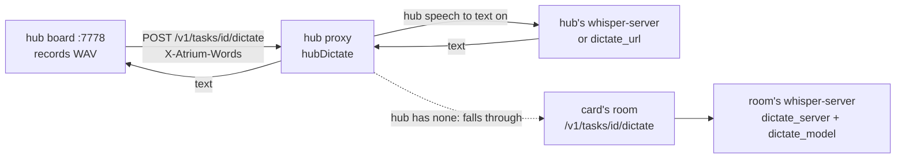
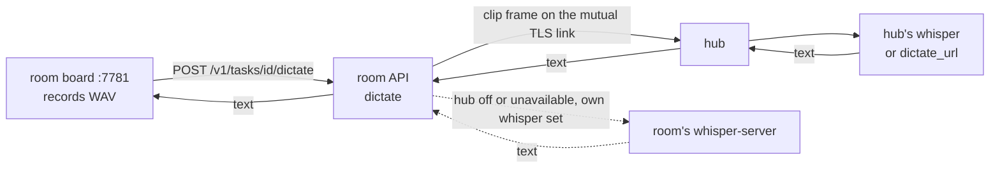
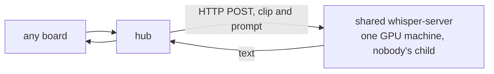

# Voice dictation

Status: built and deployed. The one open part is the tooltip wording by destination. The design is clint's, agreed in
the voice-with-clint card on 2026-11-21. Code: `internal/api/web/js/dictate.js` (desktop),
`internal/api/web/m/js/voice.js` and `m/js/compose.js` (phone),
`internal/api/dictate.go`, `internal/daemon/dictate.go`, `internal/daemon/dictate/`,
`internal/link/hubdictate.go` and `internal/link/conn/dictate.go`.

## What it is

Hold Right Ctrl or the mic button, talk, release. The words land on the card's input line and **release sends**: the
text is pasted, then Enter follows 250 ms later. Transcription is whisper.cpp's `whisper-server`, never a hosted API.

| Gesture | Result |
| --- | --- |
| Hold Right Ctrl, release | paste the text, then Enter |
| Right Ctrl and Shift, or Shift with the mic button | paste the text with a newline, no Enter, so lines add up |
| End with the send word | the word is cut off and the text is sent, even with Shift |
| Esc while listening | cancel |

The send word is `localStorage` `atrium.dictate.sendword`, default "send it", and empty turns it off.

The board records 16 kHz mono 16-bit WAV, since whisper-server cannot read the browser's webm without ffmpeg. It posts
the clip to `POST /v1/tasks/<id>/dictate` on whatever it was opened on, and pastes the `text` that comes back.

**Not set up shows on press.** Pressing the key or the mic asks `GET /v1/tasks/<id>/dictate` first, and a board with no
speech to text behind it says so then, not after the person has talked.

## Who transcribes

Where the board is opened decides.

| Board opened on | Clip goes to | Needs |
| --- | --- | --- |
| The hub (`:7778`) | The hub's whisper, whichever room holds the card | speech to text on the hub |
| A room's own board (`:7781`) or `/m/` through the hub | The room, which sends the clip up its link to the hub | the hub reachable and speech to text on |

**The room rule.** A linked room uses the hub when the hub has speech to text on. When it does not, the room uses its
own whisper if `dictate_server` and `dictate_model` are set, and only then says why it cannot. The hub being down or off
shows as "the hub is not answering" or "speech to text is off on the hub". A room with no hub (not linked) uses its own
whisper or says it is not set up.

The room dials the hub and the hub never reaches into a room (`internal/link/AGENTS.md`). The room-to-hub clip is the
room calling up on a `dictate` frame kind on the existing mutual TLS link: one clip, one answer, closed. The hub
answers the room's hello whether or not it has speech to text, so a room is never left to time out.

## The clip's path

### From the hub board

The hub answers first. With no hub speech to text it passes the request on to the card's room as it passes every other
`/v1` call, and that room uses its own whisper if it has one.

### From a room board

### To a shared dictate_url

The hub is the only caller of the shared server. Boards and rooms never hold its address.

## Where whisper runs

Three ways to give the hub a whisper, tried in this order.

1. `dictate_url`: a shared whisper-server for a company, on one machine with a GPU. The hub sends clips to it and starts
   nothing. Plain `http` to a non-loopback host is refused unless the operator confirms.
2. `dictate_server` and `dictate_model`: paths to a whisper-server binary and a ggml model on the hub's machine. The hub
   starts it on a free loopback port the first time a clip needs it, keeps it warm and restarts it when the settings
   change. It runs with one thread per core up to 8. The room has the same two settings for its own whisper.
3. Enable speech to text: a button in the hub's settings, in the "speech to text" section. It downloads the whisper.cpp
   release and a model into the hub's state folder, fills in the two paths and starts it. It shows the size and the
   source first, and checksums are pinned. It is the CPU build, and a machine with a GPU is better served by its own
   build and the paths, or a `dictate_url`.

All three are hub settings, set only from the hub's own machine (`edge.LocalOperator`), because they start a program or
send audio somewhere. On a hub with one room attached the settings request goes straight to that room, so the hub adds
its dictate fields to the room's answer itself (`oneRoomSettings`) and the section still shows. A request that names a
room explicitly goes to that room alone and does not carry the hub's section.

## Who owns the process

| Whisper | Owner | End of life |
| --- | --- | --- |
| Hub's `dictate_server` | the hub, through `dictate.Engine` | stopped with the hub, or when the settings change |
| Room's `dictate_server` | that room's daemon, through its own `dictate.Engine` | stopped with the room |
| Shared `dictate_url` | nobody in atrium | left alone, atrium neither starts nor stops it |

The owner started it, so on Windows the server sits in a job object made with `JOB_OBJECT_LIMIT_KILL_ON_JOB_CLOSE`
(`internal/daemon/dictate/tree_windows.go`). A `taskkill` of atrium is meant to take the server and its GPU memory with
it, which has not been checked on a real hub. Other platforms have no tree kill yet (`tree_other.go`).

## Words

The board sends the card names it shows in `X-Atrium-Words`, path-escaped, at most 300. The hub holds no card list, so
this is how it primes whisper to spell them (`dictate.Prompt`, then `dictate.Clean` on the way back). A room asked
directly builds the list from its own cards.

## The phone

The phone board holds the mic in the composer. The browser blocks the microphone on a plain `http` page that is not
loopback, so a board reached over `http://atrium.ziti` has no `getUserMedia`. Two ways round it:

- Mark the origin as secure in the browser. In Brave on Android that is
  `brave://flags/#unsafely-treat-insecure-origin-as-secure`,
  with the origin added, then a relaunch. Hold to talk then works in the page.
- Without the flag, the mic is a tap that opens the phone's own recorder through a file input (`accept=audio/*`,
  `capture`), and the clip it makes goes to the same dictate route. The recorder app covers the board while it records.

After each clip taken that way the status line shows `(convert, trip, whisper, KB)`: converting to WAV on the phone, the
whole round trip, the hub's time in whisper (the hub's `Server-Timing` header) and the size sent. https on the ziti
service, with a private CA on the phone, would give an in-page mic with no flag. It is backlog work.

## Privacy wording

The mic tooltip should say where audio goes: "transcribed on your hub" for a hub whisper, "sent to <host>" for a
`dictate_url`. The words "nothing leaves your machines" stay only where they are true. The tooltip does not do this yet:
it still reads "Transcribed on the card's room, nothing leaves your machines", which is wrong for a `dictate_url`.

## The board

The mic lives in the shortcut strip at the bottom of the terminal, left of "details". Its status pill rises above the
strip. The old floating mic at bottom left is gone.

## Status

| Part | State |
| --- | --- |
| Mic in the strip | built, clint said to keep the placement |
| Right Ctrl release sends, Shift adds lines, send word | built |
| Not set up shown on press | built |
| Hub transcribes hub-board clips | built, tested |
| Room clips up the link to the hub, and the room rule | built, tested at the connection, not run on a real whisper |
| `dictate_url` | built |
| Hub settings section, and the one-room hub fix | built |
| Enable speech to text, with download | built, CPU build only, the download has not been run on a real hub |
| Phone capture on an insecure origin | built, works on clint's phone |
| Tooltip wording by destination | not built |
| GPU build for the download | not built |
