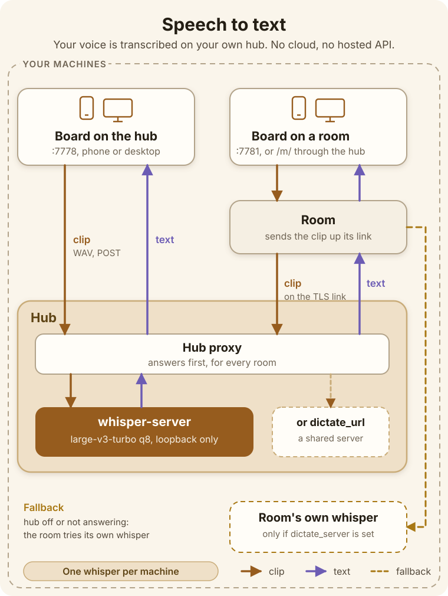

# Voice dictation

Where does the audio go? To your hub, as one short WAV clip, over the board's own connection. Where does whisper run?
In one `whisper-server` the hub starts on its own machine, on a loopback port nobody else can reach. Does anything leave
your machines? No, unless an operator points the hub at a shared `dictate_url`, and then the clip goes only there. No
hosted API and no browser speech API is involved.

Code: `internal/api/web/js/dictate.js` (desktop), `internal/api/web/m/js/voice.js` and `m/js/compose.js` (phone),
`internal/api/dictate.go`, `internal/daemon/dictate.go`, `internal/daemon/dictate/`,
`internal/link/hubdictate.go` and `internal/link/conn/dictate.go`.

## The two paths

| Board opened on | Clip goes to | Needs |
| --- | --- | --- |
| The hub (`:7778`) | The hub's whisper, whichever room holds the card | speech to text on the hub |
| A room's own board (`:7781`) or `/m/` through the hub | The room, which sends the clip up its link to the hub | the hub reachable and speech to text on |

The fallback: a room whose hub is down, too old or has speech to text off uses its own whisper when `dictate_server`
and `dictate_model` are set on the room, and only then says why it cannot. A room with no hub uses its own whisper or
says it is not set up.

**One whisper per machine.** Set the two paths on the hub only. A room on the hub's machine leaves its own unset, so
the machine holds one model in memory. A room on another machine sets its own only when it wants the fallback.

## Using it

Hold Right Ctrl or the mic button, talk, release. The words land on the card's input line and **release sends**: the
text is pasted, then Enter follows 250 ms later. Transcription is whisper.cpp's `whisper-server`.

| Gesture | Result |
| --- | --- |
| Hold Right Ctrl, release | paste the text, then Enter |
| Right Ctrl and Shift, or Shift with the mic button | paste the text with a newline, no Enter, so lines add up |
| End with the send word | the word is cut off and the text is sent, even with Shift |
| Esc while listening | cancel |

The send word is `localStorage` `atrium.dictate.sendword`, default "send it", and empty turns it off.
The Shift that adds without sending is `localStorage` `atrium.dictate.shift`: `any` (default), `ShiftLeft` or
`ShiftRight`, matched by `e.code`.
The board records 16 kHz mono 16-bit WAV, since whisper-server cannot read the browser's webm without ffmpeg. It posts
the clip to `POST /v1/tasks/<id>/dictate` on whatever it was opened on, and pastes the `text` that comes back.

**Not set up shows on press.** Pressing the key or the mic asks `GET /v1/tasks/<id>/dictate` first, and a board with no
speech to text behind it says so then, before anyone talks.

## The link

The room dials the hub and the hub never reaches into a room (`internal/link/AGENTS.md`). The room-to-hub clip is the
room calling up on a `dictate` frame kind on the existing mutual TLS link: one clip, one answer, closed. The hub
answers the room's hello whether or not it has speech to text, so a room is never left to time out.

## The clip's path

From the hub board the hub answers first. With no hub speech to text it passes the request on to the card's room as it
passes every other `/v1` call, and that room uses its own whisper if it has one. From a room board the room posts the
clip up its link and the hub answers, or the room falls back as above. With a `dictate_url` the hub is the only caller
of the shared server. Boards and rooms never hold its address.

## Where whisper runs

Three ways to give the hub a whisper, tried in this order.

1. `dictate_url`: a shared whisper-server for a company, on one machine with a GPU. The hub sends clips to it and starts
   nothing. Plain `http` to a non-loopback host is refused unless the operator confirms.
2. `dictate_server` and `dictate_model`: paths to a whisper-server binary and a ggml model on the hub's machine. The hub
   starts it on a free loopback port the first time a clip needs it, keeps it warm and restarts it when the settings
   change. It runs with one thread per core up to 8. The room has the same two settings for its own whisper.
3. Enable speech to text: a button in the hub's settings, in the "speech to text" section. It downloads the whisper.cpp
   release and a model into the hub's state folder, fills in the two paths and starts it. It shows the size and the
   source first, and the downloads are checksum-pinned. It is the CPU build. A machine with a GPU uses its own
   build through the paths, or a `dictate_url`.

All three are hub settings, set only from the hub's own machine (`edge.LocalOperator`), because they start a program or
send audio somewhere. On a hub with one room attached the settings request goes straight to that room, so the hub adds
its dictate fields to the room's answer itself (`oneRoomSettings`) and the section still shows. A request that names a
room explicitly goes to that room alone and does not carry the hub's section.

## Who owns the process

| Whisper | Owner | End of life |
| --- | --- | --- |
| Hub's `dictate_server` | the hub, through `dictate.Engine` | stopped with the hub, or when the settings change |
| Room's `dictate_server` | that room's daemon, through its own `dictate.Engine` | stopped with the room |
| Shared `dictate_url` | nobody in atrium | left alone, atrium neither starts nor stops it |

The owner started it, so on Windows the server sits in a job object made with `JOB_OBJECT_LIMIT_KILL_ON_JOB_CLOSE`
(`internal/daemon/dictate/tree_windows.go`), so ending atrium takes the server and its GPU memory with it. Other
platforms have no tree kill (`tree_other.go`), and the server is stopped on a clean exit only.

## Settings

| Setting | Where | Meaning |
| --- | --- | --- |
| `dictate_url` | hub | a shared whisper-server, tried first, atrium starts nothing |
| `dictate_server`, `dictate_model` | hub | whisper-server binary and ggml model on the hub's machine |
| `dictate_server`, `dictate_model` | room | the room's own whisper, used only as the fallback |
| Enable speech to text | hub settings | downloads whisper.cpp and a model, fills the two hub paths |

The sg4 hub runs one whisper-server from `D:/tools/whisper` with large-v3-turbo q8, bound to 127.0.0.1, 8 threads. Its
room on the same machine leaves both room settings empty.

## Troubleshooting

The board shows the sentence below. Find it, then do the fix.

| The board says | Meaning | Fix |
| --- | --- | --- |
| speech to text is off on the hub | the hub answered and has no whisper set | enable speech to text in the hub's settings, or set `dictate_url` or the two paths |
| the hub is not answering, so there is no speech to text | the room could not reach the hub and has no whisper of its own | start the hub or fix the link, or set the room's two paths for a fallback |
| the hub is older than speech to text. update the hub | the hub predates the `dictate` frame kind | update the hub |
| dictation is not set up on this room: set dictate_server and dictate_model | an unlinked room with no whisper | link the room to a hub, or set its two paths |
| speech to text is set from the machine the hub runs on | a settings change from another machine | open the hub's board on its own machine |
| the clip is over 8 MB | too long a recording | say less per clip |
| send the clip as WAV | the clip was not 16 kHz WAV | reload the board |

## Words

The board sends the card names it shows in `X-Atrium-Words`, path-escaped, at most 300. The hub holds no card list, so
this is how it primes whisper to spell them (`dictate.Prompt`, then `dictate.Clean` on the way back). A room asked
directly builds the list from its own cards.

## The phone

The browser blocks the microphone on a plain `http` page that is not
loopback, so a board reached over `http://atrium.ziti` has no `getUserMedia`. Two ways round it:

- Mark the origin as secure in the browser, per browser in "Microphone on a plain http board" below. In Brave on
  Android that is `brave://flags/#unsafely-treat-insecure-origin-as-secure`, with the origin added, then a relaunch.
  Hold to talk then works in the page.
- Without the flag, the mic is a tap that opens the phone's own recorder through a file input (`accept=audio/*`,
  `capture`), and the clip it makes goes to the same dictate route. The recorder app covers the board while it records.

After each clip taken that way the status line shows `(convert, trip, whisper, KB)`: converting to WAV on the phone, the
whole round trip, the hub's time in whisper (the hub's `Server-Timing` header) and the size sent.

## Microphone on a plain http board

A board opened at `http://atrium.ziti` or any other non-loopback `http` name is not a secure context, so the browser
hides `getUserMedia` and hold to talk cannot record. The permanent fix is TLS on the board over the overlay (backlog
`f-board-tls-over-ziti`, after 0.1.0). Until then each browser can be told to treat one origin as secure. Enter the
origin exactly as in the address bar, scheme and host and port if any, for example `http://atrium.ziti`. Every browser
below needs a full restart after the change. Then reload the board and the mic works. This lowers the browser's
protection for that origin, so list only your own board.

Verified means a vendor or browser project page names it. Unverified means only a forum report or the browser's shared
engine says so, and it is yours to try.

| Browser | Setting | Where to enter the origin | Status |
| --- | --- | --- | --- |
| Chrome, desktop | flag `unsafely-treat-insecure-origin-as-secure` | `chrome://flags/#unsafely-treat-insecure-origin-as-secure`, enable, type the origin, Relaunch | verified (Chromium docs) |
| Chrome, Android | same flag | `chrome://flags`, search for it, enable, type the origin, Relaunch | unverified, a 2018 forum answer only |
| Edge, desktop | same flag | `edge://flags/#unsafely-treat-insecure-origin-as-secure`, enable, type the origin, Restart | unverified, a 2020 forum thread says it failed in Edge 81 |
| Edge, desktop, managed | policy `OverrideSecurityRestrictionsOnInsecureOrigin` | a list of origins in the policy | verified (Microsoft Learn) |
| Edge, Android | same flag | `edge://flags`, search for it | unverified |
| Brave, desktop | same flag | `brave://flags/#unsafely-treat-insecure-origin-as-secure`, enable, type the origin, Relaunch | unverified, same engine as Chrome |
| Brave, Android | same flag | `brave://flags/#unsafely-treat-insecure-origin-as-secure`, enable, type the origin, Relaunch | in use on the sg4 phone |
| Opera, desktop | same flag | `opera://flags/#unsafely-treat-insecure-origin-as-secure` | unverified, one forum post |
| Opera, Android | same flag | `opera://flags`, search for it | unverified |
| Firefox, desktop | pref `dom.securecontext.allowlist` | `about:config`, create or edit it as a string, comma-separated hostnames, restart | verified (Mozilla bugs), hostnames only and no ports |
| Firefox, Android | pref `dom.securecontext.allowlist` | `about:config` exists only in Firefox Beta and Nightly, not Release | verified for the limit, the pref is untried on Android |
| Samsung Internet | none a user can set found | Samsung documents only the managed policy `OverrideSecurityRestrictionsOnInsecureOrigin` | no `internet://flags` entry verified |
| Safari, macOS and iOS | none | none found, WebKit allows `getUserMedia` on https only | no way found. Use the phone recorder path above, or https |

Notes.

- The Chromium flag takes a comma-separated list, so several origins fit in the one box.
- Chromium says the command-line form needs a throwaway `--user-data-dir`, and on Android that form needs a rooted
  device. The `chrome://flags` entry is the route above and does not.
- Chromium has marked this flag unsupported over time. If a browser version no longer lists it, the table's flag route
  is gone for that version and https is the way.
- On Samsung Internet and Safari the file-input recorder under "The phone" still works with no setting.

Sources: Chromium, Deprecating Powerful Features on Insecure Origins. Microsoft Learn,
OverrideSecurityRestrictionsOnInsecureOrigin. Samsung Internet developer docs, override security restrictions on
insecure origin. Mozilla bugs 1918915 and 1813163. Checked 2026-11-22.

## Where the audio goes, as the board says it

The mic tooltip reads "Transcribed on the card's room, nothing leaves your machines." That holds for a hub or room
whisper and not for a `dictate_url`, where the clip goes to the shared server's host.

## The board

The mic sits in the shortcut strip at the bottom of the terminal, left of "details". Its status pill rises above the
strip. On the phone it sits in the composer.

## Limits

- The enable download is the CPU build.
- Off Windows the whisper-server has no process-tree kill.
